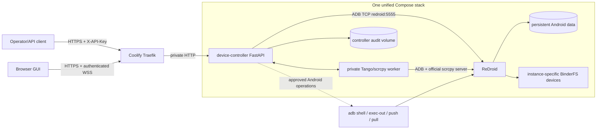
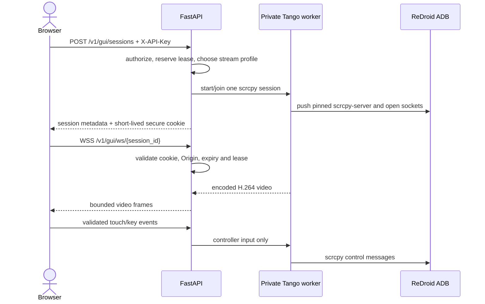

# Unified ReDroid Service — Implementation Plan

## 1. Objective

Ship each Android workload as one deployable Compose stack containing:

1. one ReDroid container; and
2. one FastAPI `device-controller` container dedicated to that ReDroid instance.

The controller will expose authenticated REST operations for device readiness,
ADB lifecycle, Android/app status, logs, approved shell/root actions, and routine
device administration. This removes external ADB dependencies and hard-coded
cross-resource networking.

Implementation started with the recommended MVP defaults. The first runtime
target remains local x86_64 WSL; production VPS/ReDroid is outside this phase.

### Current implementation status (2026-09-04)

- FastAPI controller core, typed ADB routes, feature gates, audit SQLite,
  request IDs, bounded subprocess execution and reconnect coalescing are present
  under `device-controller/`.
- GUI leases, strict-Origin WebSocket handling, a private Tango worker and a
  WebCodecs browser client are implemented structurally.
- The browser client now uses the official shadcn Vite/Radix Nova workflow with
  React 19 and Tailwind v4: responsive dark shell, Radix mobile Sheet navigation,
  a thin 9:16 phone bezel, and an accessible bottom-right resize handle. Once
  connected, only the top bar and fitted device remain in the 100dvh viewport.
- The controller image builds successfully as `linux/amd64`; Python imports,
  Node runtime and the pinned scrcpy-server checksum were smoke-tested in WSL.
- Local `.env` starts with `REQUIRE_API_KEYS=false`, explicitly confirms
  `ALLOW_INSECURE_LOCAL=true`, and contains random 32-hex placeholder keys.
  Production must set `REQUIRE_API_KEYS=true`, clear the insecure-local override
  and rotate the keys.
- The selected local ReDroid remains `redroid/redroid:14.0.0-latest` with
  `platform: linux/amd64`.
- The local unified stack is running with isolated BinderFS, loopback ADB at
  `127.0.0.1:5557`, and the controller at `http://localhost:3003`.
- `main.py` owns a FastAPI lifespan context: it starts background ADB supervision,
  yields while serving, then cancels/joins that task, shuts down GUI state and
  logs completion. Direct `python main.py` startup is supported.
- Live WSL validation proved ADB authorization, Android boot, scrcpy startup,
  H.264 configuration plus keyframe delivery through the authenticated
  FastAPI WebSocket, lease release and worker cleanup. Visual browser rendering
  and manual touch/keyboard behavior remain operator acceptance checks.

## 2. Design principles

- One controller controls exactly one configured ReDroid serial.
- ReDroid and the controller share one private Docker network, not a network
  namespace. The controller reaches `redroid:5555` through Docker DNS.
- Only the controller HTTP port is routed through Coolify/Traefik.
- ReDroid ADB is never publicly bound. Optional operator ADB remains loopback
  only and is reached through SSH.
- ReDroid remains the only privileged container. The controller receives no
  Docker socket, Binder devices, host PID/network namespace, or broad Linux
  capabilities.
- Every non-public operation is authenticated, bounded, validated, and audited.
- Named operations are the normal API. Arbitrary shell/root execution is a
  separately approved, disabled-by-default break-glass feature.
- Controller-only deployments must not recreate or restart ReDroid.
- Each stack has unique BinderFS devices and a unique persistent Android `/data`.
- Browser GUI access uses the official scrcpy protocol through the authenticated
  controller; ADB and scrcpy sockets are never routed directly to the internet.

## 3. Proposed architecture



The controller does not need `network_mode: container:redroid`. Ordinary shared
Compose networking gives it a stable service name and keeps its security context
separate from the privileged Android container.

## 4. Compose topology

The future `device-controller/docker-compose.yml` will define both services.

### `redroid`

Retain the validated ReDroid controls:

- pinned ReDroid image digest;
- `privileged: true` only on ReDroid;
- `cgroup: private` on unified cgroup v2;
- CPU, memory, swap, PID, log rotation, and stop-grace limits;
- three explicit real BinderFS mounts;
- `/dev/null:/dev/kmsg` to prevent host journal flooding;
- one persistent, instance-specific `/data` bind mount;
- boot/adbd health check;
- one NAT-capable Coolify network only;
- no public `5555:5555` mapping.

An optional operator mapping may be enabled explicitly:

```yaml
ports:
  - "127.0.0.1:${HOST_ADB_PORT:-5555}:5555"
```

It must remain loopback-only and is not required by the controller.

### `device-controller`

- Python slim image with `android-tools-adb` and FastAPI;
- pinned Node runtime only for the private Tango/scrcpy worker and web build;
- normal unprivileged container, `cap_drop: [ALL]`;
- `read_only: true` plus dedicated writable `/tmp` and audit/data volumes;
- `init: true`, bounded CPU/memory/PIDs and rotated logs;
- `DEFAULT_ADB_SERIAL=redroid:5555`;
- `depends_on: redroid: condition: service_healthy` for initial ordering;
- independent ADB reconnect logic for failures after startup;
- internal port `8001`, exposed only through Traefik;
- controller health check against `127.0.0.1:8001/healthz`.

The Coolify domain must target controller backend port `8001`. ReDroid must not
become multi-homed merely to support the controller.

## 5. Controller source layout

```text
device-controller/
├── main.py                    # app factory, lifespan, router registration
├── config.py                  # validated environment configuration
├── auth.py                    # API-key verification and principals
├── adb_client.py              # subprocess-safe ADB transport and reconnect
├── command_registry.py        # approved normal/root operation definitions
├── audit.py                   # structured redacted audit events
├── models.py                  # request/response Pydantic models
├── routers/
│   ├── health.py              # liveness/readiness
│   ├── device.py              # Android properties and device status
│   ├── apps.py                # package/process/activity operations
│   ├── logs.py                # bounded logcat and Android diagnostics
│   ├── files.py               # explicitly scoped push/pull operations
│   ├── gui.py                 # GUI leases, stream bootstrap and websocket
│   └── admin.py               # reconnect and approved root operations
├── gui/
│   ├── worker/                # private Tango ADB/scrcpy protocol worker
│   └── web/                   # browser WebCodecs client
├── tests/
├── requirements.txt
├── DockerFile
└── docker-compose.yml
```

`main.py` should remain orchestration-only; command construction and execution
must be independently testable.

## 6. Authentication and authorization

### Initial model

- `X-API-Key` on every route except `/healthz`.
- Require a high-entropy `API_KEY_ADMIN` at startup; empty means startup failure.
- Compare keys with `secrets.compare_digest`.
- Never include API keys in application logs, audit records, errors, or OpenAPI
  examples.
- Swagger `/docs`, ReDoc `/redoc`, and `/openapi.json` should be enabled. Their
  exposure is configurable; default to API-key protection for this controller.

### Extensible model

Keep authorization internally principal-based so later versions can add:

- read-only monitoring key;
- operator key for app lifecycle actions;
- admin key for root/repair actions;
- optional IP allowlist or mTLS at Traefik.

Rate-limit per principal and globally. Return `429` with `Retry-After` when an
operation queue is full.

## 7. Command execution safety

Do not accept shell text in the normal API. Each operation constructs a fixed
argument array and runs it with `shell=False`.

Every process execution must have:

- an operation-specific timeout;
- maximum stdout/stderr bytes;
- process-tree termination on timeout;
- UTF-8 decoding with replacement;
- explicit return-code handling;
- concurrency limits;
- secret redaction;
- a correlation/request ID.

Read operations may run concurrently. Mutating UI/package/root actions use a
per-device lock so two callers cannot issue conflicting global mutations.

### Approved-operation registry

The registry maps a stable operation ID to a command builder, for example:

```text
device.get_properties
device.disk_usage
device.memory
app.status
app.start
app.force_stop
app.clear_cache
logs.logcat
root.kernelsu_status
root.lsposed_status
```

Request parameters are typed and range/allowlist validated. Package names must
come from `ALLOWED_PACKAGES`; callers cannot target arbitrary installed apps by
default.

### Break-glass raw execution

Supporting “run any command/root command” turns the API into remote root access
to a privileged Android container sharing the host kernel. If approved later,
it must be isolated behind all of these controls:

- `ENABLE_BREAK_GLASS=false` by default;
- separate `API_KEY_BREAK_GLASS`;
- Traefik/VPS source-IP allowlist;
- no shell expansion unless an explicitly selected shell mode is approved;
- very short timeout and strict input/output limits;
- serialized execution;
- immutable high-severity audit record;
- no command echoed into normal access logs;
- disabled completely in customer-facing deployments.

Break-glass support is not part of the MVP.

## 8. Planned API surface

### Public lifecycle

| Method | Route | Purpose |
|---|---|---|
| `GET` | `/healthz` | FastAPI process liveness only; never invokes ADB |

### Protected readiness and inventory

| Method | Route | Purpose |
|---|---|---|
| `GET` | `/readyz` | Live ADB + Android boot readiness |
| `GET` | `/v1/device/status` | Serial, transport, boot, uptime, battery and resource summary |
| `GET` | `/v1/device/properties` | Allowlisted `getprop` values |
| `GET` | `/v1/device/packages` | Filtered installed-package inventory |
| `GET` | `/v1/device/processes` | Bounded process summary |

### Protected app operations

| Method | Route | Purpose |
|---|---|---|
| `GET` | `/v1/apps/{package}/status` | Installed/running/PID/foreground facts |
| `POST` | `/v1/apps/{package}/start` | Start an allowlisted package/component |
| `POST` | `/v1/apps/{package}/force-stop` | Force-stop an allowlisted package |
| `POST` | `/v1/apps/{package}/deeplink` | Fire a validated URI for an allowlisted package |
| `POST` | `/v1/apps/{package}/clear-cache` | Explicit high-impact cache cleanup |

### Logs and diagnostics

| Method | Route | Purpose |
|---|---|---|
| `GET` | `/v1/logs/logcat` | Bounded snapshot with line/tag/time filters |
| `GET` | `/v1/logs/kernel` | Bounded Android-side kernel log, if root policy permits |
| `GET` | `/v1/root/status` | KernelSU, Zygisk, LSPosed and `lspd` status |
| `GET` | `/v1/network/status` | Android interfaces, routes, DNS and proxy settings |
| `GET` | `/v1/storage/status` | Bounded `df`/mount summary without file contents |

### Controller administration

| Method | Route | Purpose |
|---|---|---|
| `POST` | `/v1/admin/adb/reconnect` | Restart controller ADB transport and reconnect |
| `POST` | `/v1/admin/operations/{operation_id}` | Execute one registered named operation |
| `GET` | `/v1/admin/operations` | List enabled named operations and schemas |
| `GET` | `/v1/admin/audit` | Paginated/redacted audit records |

File transfer, screenshots, screen recording, package installation, reboot, and
raw/root execution are later opt-in modules rather than MVP defaults.

## 9. Browser GUI and remote control

### 9.1 Decision

Use maintained **Tango/ya-webadb scrcpy libraries** with an exactly compatible
official pinned scrcpy server, integrated behind `device-controller`. Do not deploy a public
standalone ws-scrcpy, STF, VNC, or raw ADB service.

The durable implementation keeps two containers: ReDroid and device-controller.
The controller image may run a private Node worker beside FastAPI because the
maintained Tango protocol implementation is TypeScript. Only FastAPI is public;
the worker binds to loopback or a Unix socket and has no Traefik route.

Research snapshot: 2026-09-04.

Verified maintenance signals at that date:

- official [scrcpy v4.1](https://github.com/Genymobile/scrcpy/releases/tag/v4.1)
  was released 2026-07-12;
- Tango/ya-webadb v2.6.4 was released 2026-09-02 and its repository had only
  seven open issues;
- ws-scrcpy-web v0.1.30-beta.94 was released 2026-09-04, but had only 46 stars
  and remained explicitly beta;
- NetrisTV/ws-scrcpy's latest packaged release was v0.8.1 from 2024 and it had
  88 open issues despite receiving newer maintenance commits;
- DeviceFarmer/STF v3.7.9 was released 2026-07-08, confirming active maintenance,
  but its architecture remains a device-farm platform rather than a lightweight
  per-device relay.

### 9.2 Evaluated options

| Option | Strengths | Reliability and fit | Decision |
|---|---|---|---|
| [Tango / ya-webadb](https://github.com/yume-chan/ya-webadb) | Active MIT libraries; released packages support the official scrcpy protocol and WebCodecs and include an Android 14 delayed-ADB-ack fix | Not a turnkey hosted service, so session/auth relay must be implemented. Published package versions do not all match the repository tag and must be paired with the exact scrcpy protocol version | **Selected foundation** |
| [bilbospocketses/ws-scrcpy-web](https://github.com/bilbospocketses/ws-scrcpy-web) | Active 2026 beta; vanilla official scrcpy server; WebCodecs video/audio; built-in shell/files UI | GPL-3.0, beta, small/single-maintainer project, no real user authentication by default, and published Docker image is amd64-only while the VPS is ARM64 | Private experimental compatibility spike only; do not expose or ship as the platform |
| [NetrisTV/ws-scrcpy](https://github.com/NetrisTV/ws-scrcpy) | Mature recognizable UI; MIT; large user base | Uses a custom `scrcpy-server` derived from old v1.19 rather than current official v4.x; explicitly lacks authorization; old protocol and Android-side WebSocket design increase Android 14 maintenance risk | Reject |
| [DeviceFarmer/STF](https://github.com/DeviceFarmer/stf) | Maintained full browser device farm; inventory, booking, files, shell and control; stated Android 14/15 support | Requires a substantially larger Node/RethinkDB/ZeroMQ/provider topology and legacy support binaries. Good for a centralized fleet, not one lightweight controller per ReDroid | Do not embed; reconsider separately if a fleet portal is needed |
| ReDroid VNC + [noVNC](https://github.com/novnc/noVNC) | noVNC itself is mature and browser-compatible | noVNC is only a client. ReDroid's VNC/RfbServer is debug-only, undocumented, reported broken with software rendering/black screens, and not a stable Android 14 interface | Reject |
| droidVNC-NG + noVNC | Maintained Android VNC APK | Requires MediaProjection approval/workarounds plus AccessibilityService, adds a high-trust APK, and provides lower-fidelity VNC transport with weaker security | Emergency private fallback only |

### 9.3 Why Tango is preferred

- It tracks official scrcpy rather than maintaining an old Android fork.
- Official scrcpy needs ADB but not root and supports Android API 21+.
- Current released Tango includes a specific Android 14 stream-ordering fix.
- MIT licensing is compatible with a purpose-built controller UI.
- Browser WebCodecs avoids a heavy WASM decoder and supports direct encoded
  H.264 frames.
- We retain one authentication, authorization, audit, quota and lifecycle owner:
  FastAPI.

Tango's API is still evolving, so package versions and the official
`scrcpy-server` artifact must be pinned with checksums. The implemented released
pair is `@yume-chan/adb-scrcpy@2.3.2` with official scrcpy-server **v3.3.3**
(`SHA-256 7e70323ba7f259649dd4acce97ac4fefbae8102b2c6d91e2e7be613fd5354be0`).
Do not replace only the server with v4.1: scrcpy requires exact client/server
protocol compatibility, and Tango's v4.1 classes were not in the published
packages at implementation time. Upgrades require matching released packages
and an Android 14/ReDroid compatibility test.

### 9.4 Runtime flow



Do not give the browser a raw ADB transport. FastAPI accepts only the stream and
control message schema, and the private worker owns ADB/scrcpy protocol details.

### 9.5 Authentication for WebSockets

Browser WebSocket APIs cannot set an arbitrary `X-API-Key` header. Use a two-step
flow:

1. `POST /v1/gui/sessions` authenticates `X-API-Key` over normal HTTPS.
2. FastAPI creates an opaque, short-lived server-side lease and sets a `Secure`,
   `HttpOnly`, `SameSite=Strict` cookie scoped to the GUI WebSocket path.
3. The browser opens WSS on the same origin.
4. FastAPI validates the session ID, cookie, exact `Origin`, expiry, role and
   lease state before accepting the upgrade.

Never put an API key in a URL/query string. A single-use WebSocket subprotocol
ticket is an acceptable fallback, but it must expire in about 60 seconds and be
redacted from every log.

### 9.6 Session and concurrency model

- One Android scrcpy encoder session per ReDroid.
- One exclusive interactive controller lease.
- Up to three read-only viewers initially, all sharing the same encoded stream.
- Viewers cannot inject input, write clipboard data, upload files or call shell.
- Heartbeat every 20–30 seconds and a maximum lease of 30 minutes.
- Ten-second reconnect grace after an unexpected browser disconnect.
- Explicit release, expiry and audited admin revocation; no silent lease stealing.
- One Uvicorn worker/controller replica until leases move to shared storage.
- Slow viewers get bounded queues: drop obsolete non-keyframes, then disconnect
  instead of accumulating memory.

### 9.7 MVP stream profile

- H.264 only, because it has the broadest browser/hardware support.
- Video only; audio is deferred.
- Start at the existing 720×1280 display, 15–24 FPS and 2–4 Mbps.
- Chrome/Edge over HTTPS with WebCodecs is the supported MVP client.
- Browser capability is reported during session creation before the shared
  encoder starts.
- H.265, AV1, VP8/VP9, audio, camera, recording and multiple stream profiles are
  deferred until target-browser and ReDroid MediaCodec tests pass.

Traefik routes HTTPS and WSS through the same controller domain and port 8001;
no additional public port is required.

### 9.8 GUI API surface

| Method | Route | Purpose |
|---|---|---|
| `GET` | `/gui/` | Static authenticated browser client |
| `POST` | `/v1/gui/sessions` | Create viewer/controller lease and stream profile |
| `GET` | `/v1/gui/sessions/current` | Current principal's lease and stream status |
| `POST` | `/v1/gui/sessions/{id}/renew` | Bounded explicit lease renewal |
| `DELETE` | `/v1/gui/sessions/{id}` | Release lease and detach viewer |
| `POST` | `/v1/gui/sessions/{id}/revoke` | Admin-only forced revocation |
| `WS` | `/v1/gui/ws/{session_id}` | Authenticated video/control transport |

### 9.9 Capability boundaries

- Touch, mouse and key input: interactive controller only, rate/size limited.
- ReDroid Android 14 currently captures through a DisplayManager mirror whose
  virtual display reports `touch NONE`; scrcpy positional messages are accepted
  but do not affect display 0. The implemented `TOUCH_INJECTION_MODE=adb`
  fallback serializes bounded `input touchscreen -d 0 motionevent` commands and
  scales coordinates from the browser's actual decoded canvas dimensions.
  Pointer moves are throttled to about 30 Hz. Physical devices may switch back
  to native scrcpy injection after compatibility testing.
- Clipboard: disabled in MVP; later text-only opt-in with byte limits.
- File manager/APK install: not inherited from ws-scrcpy projects. Use separate
  scoped and audited HTTP APIs if approved later.
- Shell/root: never carried over the GUI WebSocket; use named controller routes.
- Screen recording: deferred until storage, retention and quota policy exists.
- Do not record video, screen content, typed text or clipboard content in logs.

### 9.10 Cleanup and recovery

On disconnect, expiry, shutdown or controller deployment:

1. stop accepting input;
2. close browser and worker channels;
3. stop the shared scrcpy session when its last viewer leaves;
4. remove created ADB forwards/sockets;
5. terminate the worker process tree with a bounded grace period;
6. clean up an orphaned Android scrcpy server if required;
7. release leases and write a final audit event.

Controller startup performs bounded orphan cleanup before GUI readiness. A
controller-only deployment intentionally ends active GUI sessions but must not
restart or recreate ReDroid.

### 9.11 GUI metrics and audit

Measure session grants/denials, current viewers, lease duration, stream bitrate,
frames, dropped frames, slow-client disconnects, input event counts, encoder
failures and reconnects. Audit principal, role, session ID, source, validated
Origin, stream profile and result. Never log stream payloads, API keys, cookies,
single-use tickets, typed text or clipboard values.

## 10. ADB identity strategy

The controller image includes the ADB client. A stable key is required so a
controller recreation does not produce an unauthorized device.

Recommended production design:

1. Generate one dedicated ADB keypair per unified stack.
2. Store the private key as a Coolify file secret.
3. Mount it read-only at `/run/secrets/adbkey` in the controller.
4. Set `ADB_VENDOR_KEYS=/run/secrets`.
5. Authorize only its public key in the persistent ReDroid ADB trust store.
6. Expose only fingerprints in status/audit output.

Baking a key as DW-fast-api currently does is operationally simple, but a common
base image would distribute the same private key to every customer/device. If a
baked-key option is retained, build a deployment-specific private image and
never commit the key or publish that image.

## 11. Kernel and host diagnostics boundary

“Kernel status” must distinguish two scopes:

### Android-side diagnostics

The controller may expose bounded, named ADB operations for:

- `uname`, selected `/proc` facts and Android boot properties;
- KernelSU/Zygisk/LSPosed service status;
- Android `logcat`;
- Android-side `dmesg` only if the configured root policy permits it.

Although called from Android, kernel logs can contain host-sensitive information
because ReDroid shares the host kernel. Responses require admin authorization,
redaction, byte limits and audit logging.

### Host diagnostics

The controller must not mount `/dev/kmsg`, `/proc/kmsg`, the Docker socket, or
the host journal. If host `dmesg`, Docker inspection, Binder preparation, or host
reboot control is required, use a separate host-operated collector/helper with a
narrow contract. Do not grant the public FastAPI container unrestricted host
access merely to make those endpoints convenient.

## 12. Health, recovery, and state model

Controller state should expose:

```text
starting -> connecting -> ready -> degraded -> reconnecting -> ready
```

- `/healthz` reports only process/lifespan health.
- `/readyz` performs or returns a recent bounded ADB readiness result.
- Background ADB supervision uses exponential backoff with jitter and a maximum
  reconnect frequency.
- A request may trigger one coalesced reconnect, not one reconnect per caller.
- Normal ADB failure never automatically restarts ReDroid or reboots the host.
- Root-stack problems are reported as degraded component state and use explicit
  approved recovery operations.
- Long operations receive operation IDs and status records; do not hold an HTTP
  request indefinitely.

## 13. Auditing and observability

Each protected request records:

- UTC timestamp and request ID;
- principal/key identifier (never the key itself);
- source address after trusted-proxy validation;
- operation and redacted validated parameters;
- target serial/package;
- queue wait and execution duration;
- result category and subprocess return code;
- output byte counts, not full sensitive output by default.

Use structured JSON logs plus a bounded persistent SQLite audit ledger. Configure
rotation and retention so logs cannot exhaust the VPS. Add Prometheus metrics for
request counts, failures, latency, queue depth, ADB state and reconnects without
labels containing package arguments, URLs, keys or command output.

## 14. Implementation phases

### Phase 0 — contract and threat-model approval

- Resolve section 15 decisions.
- Define the first allowlisted packages and operations.
- Define response schemas and error mapping.
- Confirm the experimental BinderFS/data paths and Coolify domain.
- Snapshot the current experimental deployment and persistent `/data`.

### Phase 1 — controller core, no unified cutover

- Implement configuration validation, API-key middleware, OpenAPI, audit layer,
  subprocess runner and ADB client.
- Implement `/healthz`, `/readyz`, device status and ADB reconnect.
- Add unit tests for authentication, command injection, timeout/output caps,
  redaction, offline ADB and reconnect coalescing.
- Build the controller image with `android-tools-adb`.

### Phase 2 — named read-only operations

- Add properties, package/process status, logcat, network, storage and root-stack
  status endpoints.
- Test against the local x86_64 WSL ReDroid; all VPS ReDroid instances remain
  untouched.
- Confirm the controller cannot access host files, Docker, Binder devices or host
  kernel logs.

### Phase 3 — GUI compatibility spike and viewer

- Use the private Tango worker against local WSL to validate official
  scrcpy-server startup, H.264 MediaCodec output, browser WebCodecs, input
  behavior and cleanup on this exact x86_64/Android 14 environment.
- Do not expose its Node port, shell, file manager or ADB endpoint publicly.
- Implement the durable private Tango worker, static browser client,
  authenticated session creation, WSS Origin validation and one viewer-only
  stream.
- Verify controller-only deployment closes the GUI session without restarting
  ReDroid.

### Phase 4 — interactive GUI and named mutating operations

- Add app start/stop/deep-link and approved maintenance actions.
- Introduce mutation serialization, idempotency keys where applicable, queue
  limits and operation cancellation/status.
- Add the exclusive GUI controller lease, validated/rate-limited input,
  heartbeats, reconnect grace, stream fan-out and bounded slow-viewer handling.
- Run concurrency, malformed-input and forced-timeout tests.

### Phase 5 — unified local WSL Compose

- Deploy one local Compose stack containing x86_64 ReDroid and controller.
- Use a dedicated local data volume and the existing WSL BinderFS mount.
- Remove external ADB dependency; controller uses `redroid:5555`.
- Expose only FastAPI through Traefik.
- Validate Android networking, ADB authorization, controller reconnect, GUI
  streaming/control and app operations. Report KernelSU/Zygisk/LSPosed as
  unavailable rather than treating their absence on the current WSL kernel as a
  controller failure.

### Phase 6 — lifecycle and failure testing

- Prove controller-only deployment with:

  ```bash
  docker compose up -d --build --no-deps device-controller
  ```

- Verify this does not recreate ReDroid.
- Test controller restart, ADB server kill, `adbd` restart, ReDroid restart,
  ReDroid recreation and VPS reboot.
- Verify persistent `/data`, ADB authorization, audit data and API readiness.
- Ensure only one ReDroid ever uses a given data path/Binder set.
- Test GUI encoder failure, browser crash, lease expiry, controller contention,
  viewer backpressure, worker crash and orphan scrcpy cleanup.

### Phase 7 — production template

- Parameterize device ID, data path, Binder paths, resource limits, host ADB
  loopback port, API domain and allowed packages.
- Document key generation/rotation, backup, deployment, rollback and recovery.
- Run stability checks for CPU, memory, PIDs, PSI, OOM events, restarts and
  kernel-critical logs.
- Promote the template only after experimental acceptance.

## 15. Decisions required before implementation

The following choices should be approved with the plan:

1. **Command scope:** named allowlisted operations only for MVP (recommended), or
   include break-glass arbitrary Android shell/root execution.
2. **Kernel scope:** Android-side status/logs only (recommended), or add a
   separate host collector for host `dmesg` and Docker/kernel facts.
3. **ADB key delivery:** per-stack Coolify secret mount (recommended), or a
   deployment-specific private image with the key baked in.
4. **API exposure:** public `/healthz` only with all other routes/keyed docs behind
   `X-API-Key` (recommended), or expose docs without authentication.
5. **First target:** use only the local x86_64 WSL ReDroid for implementation and
   lifecycle testing; do not alter VPS production or experimental instances.
6. **Initial package allowlist:** identify the apps/components the MVP may manage.
7. **GUI access:** one exclusive controller plus three viewers (recommended), or
   a different concurrency/lease policy.
8. **GUI scope:** H.264 video and input only for MVP (recommended); clipboard,
   files, APK install, shell, audio and recording remain separate later modules.

## 16. Acceptance criteria

- One `docker compose up` creates exactly one ReDroid and one controller.
- Controller reaches only its paired ReDroid through Docker DNS.
- No public host or OCI ingress path exposes ADB port 5555.
- Empty/invalid API configuration fails startup.
- Every protected route rejects a missing/incorrect key.
- Inputs cannot introduce extra shell commands or target unapproved packages.
- Timeouts and output limits work for normal and root operations.
- Audit records are complete, bounded and secret-free.
- `/healthz`, `/readyz`, Swagger, ReDoc and OpenAPI behave as documented.
- Controller-only redeploy does not recreate ReDroid.
- ReDroid recreation preserves `/data`, and the controller reconnects cleanly.
- Experimental Android networking, KernelSU, Zygisk and LSPosed remain healthy.
- `/gui/` works through HTTPS/WSS without exposing ADB or worker ports.
- One shared H.264 stream supports the approved viewer count within bounded CPU,
  memory and bandwidth.
- Controller leases, viewer permissions, Origin checks, expiry and cleanup work
  under disconnect/race/failure tests.
- Production `redroid14` is untouched throughout experimental development.
