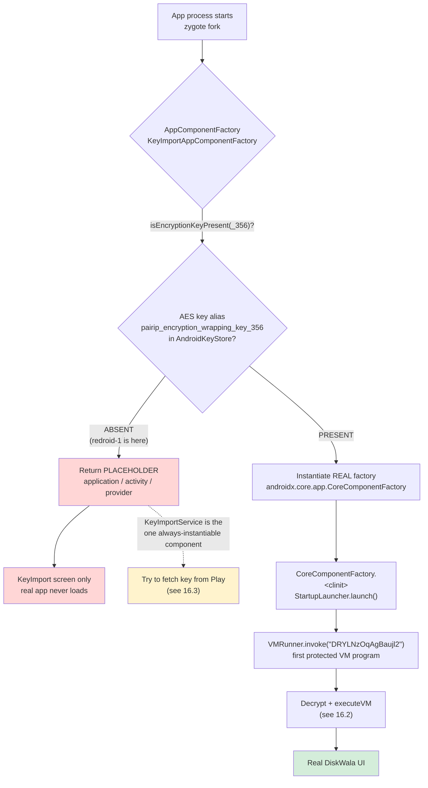
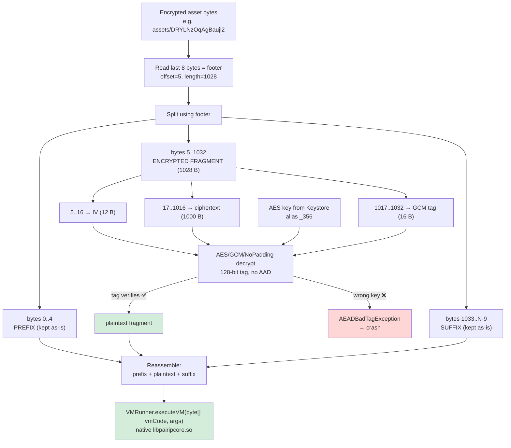
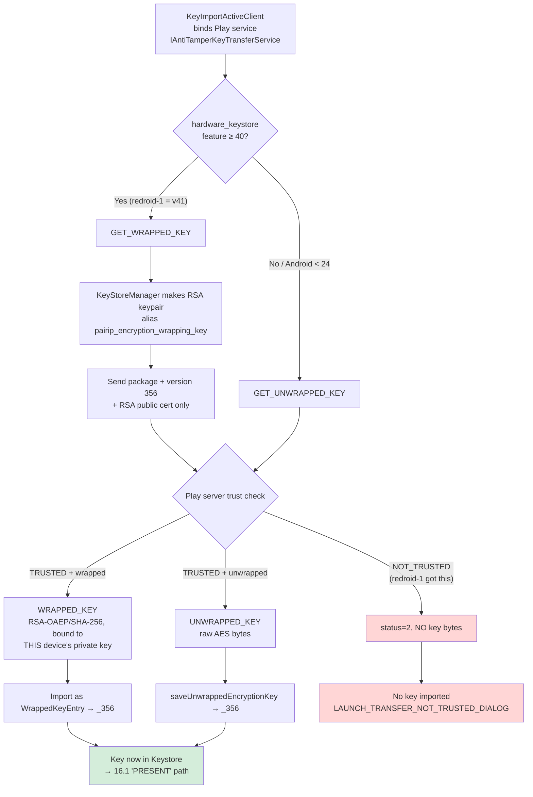
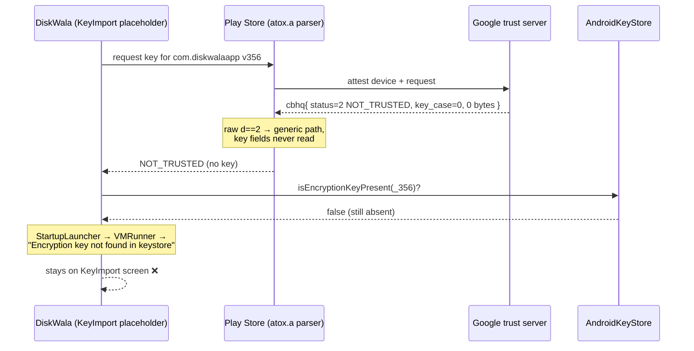
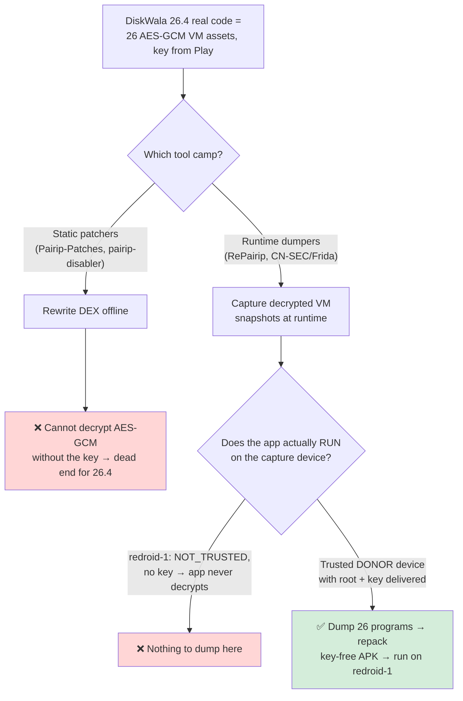

# PairIP VM Encryption — Key-Import Gate: Complete Investigation Journal

> Target: `com.diskwalaapp` (DiskWala) **26.4 / versionCode 356**, ARM64, running on x86_64 ReDroid (`redroid-1`).
> Scope of this document: the **PairIP VM-encryption key-import gate** discovered after the earlier BASIC/DEVICE integrity work in [DW_26_1.md](DW_26_1.md) and [DW_26_1_part2.md](DW_26_1_part2.md) was already complete.
> Date of the recorded investigation: **2026-09-25**.
> Nature: reverse-engineering **journal**, not a fix. Every measured fact is separated from interpretation and hypothesis.

---

> ## ✅ RESOLVED (2026-09-27) — see [DW_ENABLE_PLAYSTORE_INSTALL.md](DW_ENABLE_PLAYSTORE_INSTALL.md)
> The `NOT_TRUSTED` conclusion below was correct **for the device state investigated here** (a non-catalog-eligible ReDroid). It was later **overcome by a different route** — not by bypassing the key gate, but by making the emulator a **genuine, Play-catalog-eligible Pixel 8** so a **real Play Store install** occurs:
> - Built a fresh **ReDroid 15** instance (`redroid17_64only`) impersonating a **Pixel 8 (`shiba`)**: KernelSU + Zygisk Next + MindTheGapps 15 + `redroid_pixel8` identity + **PIF** (verified shiba Canary fingerprint) + **TrickyStore** keybox (DEVICE) + coherent patch `2026-09-05`.
> - **Decisive lever:** a full **Pixel 8 hardware-feature profile** (`pixel8_features`, 54→123 features) cleared Play's `restriction=9` device-catalog filter → **"app not available" became Install**.
> - A **genuine Play install** (`initiatingPackageName=com.android.vending`) then natively satisfied *both* PairIP gates: the native install-source check **and** the key-transfer, which returned **TRUSTED** and delivered the AES VM key → DiskWala **decrypted and launched**.
> - **Notably, STRONG integrity still FAILED** (BASIC+DEVICE only). So PairIP's key-transfer does **not** require STRONG — it requires a *genuine Play-delivered install on a DEVICE-trusted, catalog-eligible device*. No `UNWRAPPED_KEY` capture / RePairip was needed.
>
> The analysis below remains valid as the record of *why a non-eligible device is refused*; the fix is the catalog-eligibility + genuine-install route.

---

## 0. Executive summary

DiskWala 26.4 no longer fails on Play Integrity. It fails on a **second, independent protection layer**: Google PairIP's **VM-encryption + Play-mediated key import**. The app's real bytecode is shipped as **AES-GCM-encrypted VM programs** whose decryption key is *not* in the APK. That key must be delivered at runtime by the Play Store through a "secure data transfer" / anti-tamper key-transfer service, and is bound to the device's hardware Keystore.

On `redroid-1` the Play Store server answers the key-transfer request with **`NOT_TRUSTED`** and returns **no key material at all**. This was proven, not assumed, by tracing the Play Store's own response parser **before** it normalizes the result.

**Bottom line (as investigated here): there is no verified *no-key bypass*.** No no-key bypass is supported by the decompiled source, no public tool implements this exact 26.4 flow, and the raw server response carries nothing to decrypt with. The only source-consistent, *conditional* path forward requires an **authorized, trusted, instrumentable donor device that actually receives an `UNWRAPPED_KEY`** for this exact build.

> **Superseded 2026-09-27:** the practical solution turned out to avoid the key gate entirely — make the emulator a **Play-catalog-eligible Pixel 8** so a **genuine Play install** delivers the key normally (key-transfer → TRUSTED). See the banner above and [DW_ENABLE_PLAYSTORE_INSTALL.md](DW_ENABLE_PLAYSTORE_INSTALL.md).

---

## 1. Current status (as of 2026-09-25)

| Item | State |
|---|---|
| DiskWala launches to its real UI on redroid-1 | **No** — blocked at PairIP VM decryption |
| Play Integrity BASIC / DEVICE | **Pass** (from prior work) |
| Play Integrity STRONG | Fail (x86 platform limit; see [DW_26_1.md](DW_26_1.md)) |
| PairIP VM key present in DiskWala's Keystore (`_356`) | **Absent** |
| Play key-transfer server verdict on redroid-1 | **`NOT_TRUSTED`, no key bytes** (measured) |
| PGSTrace Play Store trace module | Built, deployed, captured **one** response, then **removed** |
| Gate diagnostics module (`dw26_gate_probe` v0.10) | Installed **OFF/OBSERVE**, failed override experiments removed |
| Working bypass | **None on `redroid-1`** (later solved on a new catalog-eligible Pixel 8 instance — see [DW_ENABLE_PLAYSTORE_INSTALL.md](DW_ENABLE_PLAYSTORE_INSTALL.md)) |
| redroid-2 / redroid-3 | **Untouched** during this investigation |
| DiskWala install metadata | `installerPackageName=com.android.vending`, `packageSource=1` (preserved) |

**Honest statement carried through the whole session:** *"I do not yet have a working bypass. I cannot honestly promise a same-day fix with the currently available access."*

---

## 2. Environment and exact target identity

- Host: WSL2 on x86_64; ReDroid `redroid/redroid:14.0.0-latest`; Android 14 / API 34.
- ARM translation via `libndk_translation` (`libnb.so` bridge) — see [DW_26_1.md](DW_26_1.md) §3.
- Multi-device controller config: [DW-fast-api/diskwala_config.json](DW-fast-api/diskwala_config.json) defines `redroid-1` (adb 5555, weight 40), `redroid-2` (5557), `redroid-3` (5559). Only `redroid-1` was used here.

**Exact build under analysis (verified by hash):**

- Package: `com.diskwalaapp`
- versionName `26.4`, versionCode `356`
- base APK SHA-256: `7789A7947B6E110D957C7C1D95D12718A83A70D3DDCE3C1A3CF15542B0A5043F`
- Native ABI: `arm64-v8a`, includes `libpairipcore.so`
- Source APK set extracted from: `rev-eng/apk-extractor/target-apk/DiskWala_26.4.apks`
- Decompiled tree (partial): `rev-eng/apk-extractor/jadx-java-src/` (extractor: [rev-eng/apk-extractor/apk_extractor.py](rev-eng/apk-extractor/apk_extractor.py))
- The JADX tree self-reports partial extraction: `rev-eng/apk-extractor/jadx-java-src/.jadx-partial.json`.

---

## 3. What the gate actually is (the two protection layers)

The earlier documents ([DW_26_1.md](DW_26_1.md), [DW_26_1_part2.md](DW_26_1_part2.md)) solved **layer 1**: Play Integrity / installer / `UNKNOWN_INSTALLED` state. This investigation is entirely about **layer 2**, which is separate and independent.

**Layer 2 — PairIP VM encryption + Play key import.** Google's PairIP "Automatic Protection" ships the app's real code as encrypted VM programs and gates them behind a Play-mediated, hardware-bound key. The relevant decompiled sources live under `rev-eng/apk-extractor/jadx-java-src/sources/com/pairip/`:

| Source file | Role |
|---|---|
| `com/pairip/VMRunner.java` | Loads an encrypted asset, decrypts it, hands bytecode to native `executeVM` |
| `com/pairip/VmDecryptor.java` | AES-GCM decryption + Keystore alias resolution |
| `com/pairip/StartupLauncher.java` | Runs the first protected program at process start |
| `com/pairip/application/Application.java` | `attachBaseContext` → signature + license checks |
| `com/pairip/SignatureCheck.java` | APK signature integrity verification |
| `com/pairip/vmencryption/KeyImportAppComponentFactory.java` | Replaces app components with placeholders until the key exists |
| `com/pairip/vmencryption/KeyImportActiveClient.java` | Talks to Play's anti-tamper key-transfer service |
| `com/pairip/vmencryption/KeyStoreManager.java` | Creates the RSA wrapping key, imports the AES VM key |
| `com/pairip/vmencryption/KeyImportService.java` | Imports the delivered key into DiskWala's Keystore |
| `com/pairip/vmencryption/KeyImportConstants.java` | Hardcodes versionCode `356`, Play package, original factory |

The observed runtime failure chain is:

```text
CoreComponentFactory.<clinit> -> StartupLauncher -> VMRunner -> VmDecryptor: "Encryption key not found in keystore"
```

Because the key alias `pairip_encryption_wrapping_key_356` is absent, the first protected VM program cannot decrypt, so the process never reaches DiskWala's real UI.

---

## 4. The exact VM decryption mechanism (measured from source)

From [rev-eng/apk-extractor/jadx-java-src/sources/com/pairip/VmDecryptor.java](rev-eng/apk-extractor/jadx-java-src/sources/com/pairip/VmDecryptor.java) and [.../com/pairip/VMRunner.java](rev-eng/apk-extractor/jadx-java-src/sources/com/pairip/VMRunner.java):

- Cipher: `AES/GCM/NoPadding`, 12-byte IV, 128-bit (16-byte) authentication tag, **no AAD**.
- `VMRunner.versionCode` is hardcoded to `356`; every load calls `VmDecryptor.decrypt(..., 356, ...)`.
- The runtime alias is therefore always `pairip_encryption_wrapping_key_356` (`getEncryptionKeyAlias`). Alias `_353` (26.2) cannot decrypt any 26.4 asset.
- Native side: `VMRunner.executeVM(byte[] vmCode, Object[] args)` in `libpairipcore.so` (`System.loadLibrary("pairipcore")`).

**Encrypted-fragment envelope** (each of the 26 VM assets shares this footer layout, per subagent VM analysis):

| Bytes | Meaning |
|---|---|
| last 8 bytes | big-endian `offset=5`, `length=1028` (structural footer, removed) |
| `0..4` | prefix, retained unchanged |
| `5..16` | GCM IV (12 bytes) |
| `17..1016` | ciphertext (1,000 bytes) |
| `1017..1032` | GCM authentication tag (16 bytes) |
| `1033..N-9` | suffix, retained unchanged |

- The startup asset is `assets/DRYLNzOqAgBaujl2` (376,854 bytes), named in [StartupLauncher.java](rev-eng/apk-extractor/jadx-java-src/sources/com/pairip/StartupLauncher.java).
- Every candidate VM asset has a **non-empty** encrypted fragment. There is **no** plaintext asset and **no** zero-length decryption fallback — so a "skip the key" shortcut has nothing to fall back to.
- The reconstructed plaintext program returned by `decrypt` = preserved prefix + decrypted fragment + preserved suffix (envelope removed). That exact byte array is what native `executeVM` consumes.

**Consequence:** a random or wrong AES key is rejected by GCM tag verification. Only a key that authenticates all 26 fragments is valid.

---

## 5. The Play key-import flow (wrapped vs unwrapped)

From [KeyImportActiveClient.java](rev-eng/apk-extractor/jadx-java-src/sources/com/pairip/vmencryption/KeyImportActiveClient.java) and [KeyStoreManager.java](rev-eng/apk-extractor/jadx-java-src/sources/com/pairip/vmencryption/KeyStoreManager.java):

The app binds Play's service `com.android.vending.securedatatransfer.IAntiTamperKeyTransferService` and picks a mode:

- **Android < 24, or no `android.hardware.hardware_keystore` feature ≥ 40** → `GET_UNWRAPPED_KEY`
- **hardware keystore feature ≥ 40** → `GET_WRAPPED_KEY`

`redroid-1` reports hardware keystore feature version **41**, so stock 26.4 chooses the **wrapped** path.

**Wrapped path (what redroid-1 would use):**

1. `KeyStoreManager.getWrappingKey()` creates/retrieves RSA alias `pairip_encryption_wrapping_key`.
2. Only the RSA **public certificate** encoding is exported to Play.
3. Play receives package name, version `356`, and that public key.
4. Play returns `WRAPPED_KEY`.
5. The app imports it as a `WrappedKeyEntry` under `_356`, wrapped with `RSA/ECB/OAEPPadding` + SHA-256.

The wrapped byte array is cryptographically bound to **that device's** AndroidKeyStore RSA private key. **Copying it to another device cannot work** — the target must generate its own RSA key and receive a fresh response wrapped to its own public key, which requires Play to trust the target.

**Unwrapped path:**

1. Play returns `UNWRAPPED_KEY` bytes in the response bundle.
2. Held briefly as a Java `byte[]`.
3. `saveUnwrappedEncryptionKey` imports it as AES/GCM/NoPadding into `_356`.

**`getEncoded()` is not an export path.** AndroidKeyStore secret keys are opaque; `KeyStore.getKey(alias,null).getEncoded()` returns `null` for the AES key. The source only calls `getEncoded()` on the RSA *public certificate*, never on the AES secret. So "import the key, then read it back out" is not a design that works.

---

## 6. Why a "no-key" / static bypass does not work

Three independent barriers were each investigated and each holds.

### 6.1 The component factory hides the whole app until the key exists

[KeyImportAppComponentFactory.java](rev-eng/apk-extractor/jadx-java-src/sources/com/pairip/vmencryption/KeyImportAppComponentFactory.java) checks `isEncryptionKeyPresent()`. While alias `_356` is absent it returns **placeholder** application/activity/provider objects, not the real ones. The manifest sets:

- application: `com.pairip.application.Application`
- component factory: `com.pairip.vmencryption.KeyImportAppComponentFactory`

So without the key the process only ever shows the KeyImport placeholder UI. `KeyImportService` is the one component always instantiable (so it can perform the import), even before normal components.

### 6.2 Startup is mandatory, not cosmetic

If the key *were* present, the original factory (`androidx.core.app.CoreComponentFactory`) is instantiated and its `<clinit>` immediately calls `StartupLauncher.launch()` ([StartupLauncher.java](rev-eng/apk-extractor/jadx-java-src/sources/com/pairip/StartupLauncher.java)), which runs the first protected VM program `DRYLNzOqAgBaujl2`. A second guarded `StartupLauncher.launch()` also exists in `p130k5/q.java` (the superclass of `DiskWalaApp`).

A **no-op** `StartupLauncher` only suppresses that first program; every other rewritten method still calls `VMRunner.invoke` with no key, so the missing-key crash is merely deferred.

### 6.3 The app's real lifecycle bodies are opaque reflective dispatches

The decisive blocker is DiskWala's own code. Its earliest lifecycle methods are replaced by reflective `Method.invoke` calls into holder classes that have **no Java initializer**:

```java
// DiskWalaApp.onCreate()      (com/diskwalaapp/app/DiskWalaApp.java:293-296)
empfRxW.RaUuKDEwFbjp.invoke(null, this);

// MainActivity.onCreate(Bundle)
eUYWNRr.ynlAvpBw.invoke(null, this, bundle);
```

- Holder `com/vungle/ads/internal/model/LYd/empfRxW.java` — only uninitialized `public static Method` fields.
- Holder `io/bidmachine/analytics/internal/I/TUs/eUYWNRr.java` — same.
- `PreloadInfoContentProvider` has five more opaque static `Method` calls (`onCreate`, `insert`, `update`, `query`, `delete`).

Full seven-DEX analysis (`classes.dex`..`classes7.dex`) found **no uniquely bindable static implementation** to reconstruct these. The only type-compatible candidates are Dagger/Hilt instance injectors (`k5.i.b`, `k5.e.a`) or `super.onCreate` wrappers (`onCreate$001`) — none can be the reflective target. Those `Method` fields are therefore populated only by the protected startup/native path, which needs the key. **Conclusion: no source-based static reconstruction exists.**

### 6.4 Complete direct `VMRunner.invoke` inventory (26 VM assets)

Subagent DEX reference analysis mapped every direct caller. **21** of the 26 assets partition exactly across `classes.dex`..`classes7.dex`; the remaining **5** appear in no DEX and have no static callsite (unused/provisioned or native/reflection-selected).

| Asset | Runtime caller | Origin |
|---|---|---|
| `DRYLNzOqAgBaujl2` | `com.pairip.StartupLauncher.launch()` | **PairIP startup** |
| `vySNKeEyeubB9Gsq` | `Q5.A0$b.onReceive` | media-volume receiver |
| `UIw3OVEKBQKV7Nlk` | `androidx.work...CombineContinuationsWorker.doWork` | AndroidX WorkManager |
| `yX6tD6himcihiCoH` | `...gms.ads...OfflinePingSender.doWork` | Google Ads |
| `oODviFLt1fGz2zKD` | `...gms.ads...zzcf.onReceive` | Google Ads |
| `6INTTHUsMDOS5AoB` | `...gms.ads...zzp.onReceive` | Google Ads |
| `ERv9O8rgxtA7ASaS` | `...gms.internal.ads.zzazz.onReceive` | Google Ads |
| `oBm0VfJXkMtpe24Q` | `...gms.internal.ads.zzbci.onReceive` | Google Ads |
| `5dacwXU30RcklHzN` | `...gms.internal.ads.zzeo.onReceive` | Google Ads |
| `MkHZ5ov8ApRm4SWx` | `com.inmobi.media.Vl.onReceive` | InMobi |
| `PJgGXSOjoYIyIZQg` | `com.ironsource.adqualitysdk...onReceive` | IronSource (inferred) |
| `U7ZHXlKyuZqS1NQU` | `com.mbridge.msdk.out.LoadingActivity$1.onReceive` | MBridge |
| `sW1k1ImN5JC3ZM11` | `d4.e.onReceive` | unresolved 3rd-party receiver |
| `1Q0XHhcDQxMPCcBI` | `io.appmetrica.analytics.impl.H2.onReceive` | AppMetrica |
| `mC3Uj5UxkIxVJBEB` | `io.bidmachine.media3...NetworkTypeObserver$Receiver.onReceive` | BidMachine |
| `SEuO0siVTdy73axV` | `io.bidmachine.media3...StreamVolumeManager$VolumeChangeReceiver.onReceive` | BidMachine |
| `ZruENzvGpk3dqUEC` | `io.bidmachine.media3...RequirementsWatcher$DeviceStatusChangeReceiver.onReceive` | BidMachine |
| `y0HeAClJXgq9UrWc` | `j.f$k$a.onReceive` | AndroidX/AppCompat-renamed |
| `DwAUbyKpOxumshy8` | `yads.ct5.doInBackground` | Yandex Ads |
| `u71bVB5r3IFEVgoy` | `yads.ht5.doInBackground` | Yandex Ads |
| `LNtNEYcjEu56my3b` | `yads.zv4.onReceive` | Yandex Ads |
| `5FzltWuurNQgGYMa` | *(no DEX literal / no callsite)* | unmapped |
| `BDOfO4DQ8543TGYs` | *(no DEX literal / no callsite)* | unmapped |
| `HBdWNCKH5ZxXfl1h` | *(no DEX literal / no callsite)* | unmapped |
| `f6fj71xsGmNCVy7g` | *(no DEX literal / no callsite)* | unmapped |
| `fKGVGc7fKAu9qHU7` | *(no DEX literal / no callsite)* | unmapped |

The 20 non-startup mapped assets are dependency/ad/analytics callbacks — **not** DiskWala business methods. That does *not* prove the app's own logic survives without startup; the three earliest DiskWala lifecycle paths are already the opaque reflective dispatches of §6.3.

---

## 7. Chronological journey — what was attempted, in order

This section is the honest narrative of the session, including corrected assumptions.

### 7.1 Starting point

DiskWala 26.4 was already installed as a Play-signed system app with BASIC/DEVICE integrity passing (prior work). It still crashed to the PairIP KeyImport screen. The runtime log showed `StartupLauncher -> VMRunner -> VmDecryptor: Encryption key not found in keystore`. The Play Store separately marked DiskWala **incompatible** and its VM-key request returned **`NOT_TRUSTED`**.

### 7.2 The two user questions that framed the work

> **"Play Store still marks DiskWala incompatible and refuses its VM-key request with NOT_TRUSTED. Can we capture it using middleware and set it to trusted? Also can we extract this key from my non-rooted device using some app?"**

Both were answered with evidence, and both initial hopes were **corrected**:

- **Middleware "set trusted":** Only helps *if* the server actually returns key material that Play Store then withholds. If the raw response has no key, flipping the status yields nothing to decrypt with. This had to be **measured**, not assumed.
- **Extract key from a non-rooted phone via an app:** **Not possible.** Keystore entries are per-UID and hardware-backed keys are non-exportable even to their owning app. APK extractors, backups, and Shizuku do not overcome this. `KeyImportService` exposes key *import*, not export.

### 7.3 Feasibility analysis (before touching the device)

Two read-only subagent investigations established the cryptographic reality (full detail in §11):

1. **Trace VM key feasibility** — the only viable transfer is a genuine `UNWRAPPED_KEY` for the exact 356 build; a hardware-backed donor only receives a **non-portable wrapped key**.
2. **Assess decrypted program portability** — replaying donor-decrypted plaintext VM programs is *conditionally* stronger than a no-op launcher, but is not a proven bypass and may still fail in native `pairipcore`.

### 7.4 User authorized an on-device measurement

> **"sure go ahead - i want this fixed today at any cost"**

Decision: trace the Play Store's key-transfer response on **redroid-1 only**, metadata-only, no key/token/account logging, with redroid-2/3 and the working donor phone untouched. This produced the **PGSTrace** module (§8).

### 7.5 Building and deploying PGSTrace

1. **Locate PGS response parser** (subagent) — identified the exact Play Store class/method that parses the key-transfer response and the field that carries key bytes.
2. **Build trace scaffolding safely** (subagent) — created a metadata-only LSPosed module with a strict target guard and unit tests.
3. **Verify raw parser mapping** (subagent) — confirmed runtime class names from raw DEX and the exact proto field layout.
4. **Audit suggested PairIP research** (subagent) — checked the public GitHub repos the user referenced; none implement this 26.4 flow.
5. Deployed the signed module to redroid-1, enabled it for **one** request, captured the raw response, then **disabled and removed** it.

### 7.6 The measurement (decisive)

The trace read the response **before** Play Store's parser normalizes it. Result (§9):

```text
raw_status = 2  (NOT_TRUSTED)
key_case   = 0  (no wrapped, no unwrapped)
protection_key_bytes = 0
encrypted_key_data_bytes = 0
```

**The server returns no key at all.** Rewriting the status to "trusted" would therefore supply nothing to decrypt with. The misleading "Successfully retrieved … key" log line means the *retrieval operation completed*, not that a key arrived.

### 7.7 Falling back to static patching — and why it also failed

With no key from the server, the remaining option was a no-key static bypass. Two more read-only subagents (§11) closed this door:

- **Audit protected callsite reconstruction** — startup is not cosmetic; the app's lifecycle bodies are opaque reflective dispatches.
- **Locate relocated lifecycle implementations** — no uniquely bindable static implementation exists across all seven DEX files.

The failed gate override experiments (version spoofing, key-request spoofing) were removed and replaced with a **disabled diagnostics-only** build.

### 7.8 Documentation phase

The user asked for this journal. Because earlier turns spent too long re-verifying citations inline, the work was split across subagents: one **writer** plus two **read-only verifiers** (chronology/evidence and source/artifact citations). Their findings are folded into this document.

---

## 8. PGSTrace — the metadata-only Play Store response tracer

The one on-device instrument built in this investigation. Its entire purpose was to read the **raw** key-transfer response before Play Store discards key fields, and to prove or disprove that a key ever arrives.

### 8.1 Files

Under `rev-eng/mod_build/pgstrace/`:

| File | Purpose |
|---|---|
| `AndroidManifest.xml` | LSPosed module manifest, `xposedminversion`, description |
| `module.prop` | Module id/name/version, "no mutation" description |
| `assets/xposed_init` | Names the hook entry class `com.recon.pgstrace.Hook` |
| `src/com/recon/pgstrace/TracePolicy.java` | Pure-logic target guard + metadata formatter |
| `src/com/recon/pgstrace/Hook.java` | The LSPosed hook that observes `atox.a(Object)` |
| `tests/com/recon/pgstrace/TracePolicyTest.java` | Pure-Java unit tests (no Android) |

Build script: `rev-eng/mod_build/build_pgstrace.sh` (compiles, runs `TracePolicyTest`, packages, signs). Verified with `bash -n` and the test suite before deployment.

### 8.2 Target and guard

- Hook class/method (raw DEX): `Latox;->a(Ljava/lang/Object;)Lbsce;` in Play Store (`com.android.vending`).
- Related proto runtime classes: `cbhr` (response container), `cbhs` (response item), `cbhq` (the key/status message), `cbma` (byte field).
- `TracePolicy.shouldTrace(loadedPackage, loadedProcess, targetPackage, targetVersionCode, targetBaseApkSha256, enabledFlag)` requires **all** of:
  - Play Store package and one of its known processes,
  - exact Play Store APK SHA-256,
  - the DiskWala request carrying **versionCode 356**,
  - an on-disk enable flag equal to exactly `"1"` (`/data/local/tmp/pgstrace.enabled`).
- `MAX_EVENTS` capped at 32.

### 8.3 What it records (and refuses to record)

`Hook.java` emits only **primitive metadata** via `TracePolicy.metadata(...)`:

- captured package name / version code (request attribution fields on `atox`),
- response-list cardinality and `cbhs.b` tag,
- raw `cbhq.d` status int + mapped label,
- `cbhq.b` key oneof **case** (0 / 3 wrapped / 6 unwrapped),
- boolean field-presence bits from `cbhq.f` has-bits,
- `cbma.d()` **length only** for the extra byte field.

It **never** reads, stringifies, copies, or logs the actual key bytes (`cbhq.c`/`cbhq.e` contents). It observes with `beforeHookedMethod` and does not mutate the response — the explicit non-mutation guarantee is in the Hook header.

### 8.4 Play Store binary analyzed

- APK: `phonesky-53.2.23-85322340.apk` (Play Store build 85322340).
- SHA-256: `ab89dd8ac35b6548f54ae761cb8e5d5b182602fc02b95650722c60f60c3929c7`.
- Supporting JADX/smali artifacts saved under `%LOCALAPPDATA%\Temp\kilo\` (`phonesky-jadx-atox-simple/`, `-cbhr/`, `-cbhs/`, `-cbhq/`, `-cbma/`, `phonesky-atox-raw.smali`, `phonesky-cbhq-rawmessageinfo-decoding.txt`, `phonesky-pgs-string-xrefs.txt`).

### 8.5 Proto field map (verified from RawMessageInfo)

`cbhq` message:

- status `d` = field 1, present when `(f & 0x1) != 0`; values: `0` unknown, `1` success, `2` `NOT_TRUSTED`, `3` key-not-required, `4` not-licensed.
- key oneof: payload field `c`, oneof-case field `b` (`3` wrapped, `6` unwrapped).
- extra bytes `e` = field 2 (`cbma`), present when `(f & 0x2) != 0`; `cbma.d()` returns byte length, `cbma.B()` is `length==0`.

Branch behavior: for raw `d == 2` (`NOT_TRUSTED`), Play Store's `atox.a` takes the generic path and does **not** read `cbhq.b/c/e`; downstream `atoo.a` only builds the `com.google.android.finsky.LAUNCH_TRANSFER_NOT_TRUSTED_DIALOG` PendingIntent. This is exactly why an app-side trace was insufficient and the trace had to sit at the raw parser.

---

## 9. The decisive measurement

One request was captured on redroid-1 with the trace enabled, then the trace was removed. Evidence saved to `%LOCALAPPDATA%\Temp\kilo\pgs-356-redroid1-result-20260925.json`:

```json
{
  "target_package": "com.diskwalaapp",
  "target_version_code": 356,
  "raw_status": 2,
  "raw_status_label": "NOT_TRUSTED",
  "key_case": 0,
  "wrapped_key_selected": false,
  "unwrapped_key_selected": false,
  "protection_key_bytes": 0,
  "encrypted_key_data_bytes": 0,
  "presence_bits": 1,
  "play_store_build": 85322340
}
```

**Measured facts:**

- The server verdict is `NOT_TRUSTED` (raw, pre-normalization).
- `key_case = 0`: neither a wrapped nor an unwrapped key is present.
- Both key byte-lengths are `0`.
- Only the status has-bit is set (`presence_bits = 1`); the key/extra-bytes fields are absent.

**Interpretation (kept separate from the measurement):** since the raw response contains no key bytes, a middleware that rewrites the status to "trusted" would have **nothing to decrypt with**. The earlier idea of "capture and flip to trusted" is therefore not viable for this device state.

---

## 10. The gate diagnostics module (`dw26_gate_probe` v0.10)

A second LSPosed module under `rev-eng/mod_build/gate/`, scoped to `com.diskwalaapp`. Earlier turns used it to try version/key-request spoofing; those override experiments were **removed** after they failed, and it was left installed **OFF/OBSERVE**.

### 10.1 Modes ([GateMode.java](rev-eng/mod_build/gate/src/com/recon/dw26gate/GateMode.java))

| Mode | Behavior |
|---|---|
| `OFF` / `OBSERVE` | Metadata-only. Missing/unknown mode **fails safe to OBSERVE**. Legacy body/key-oracle diagnostics are skipped. |
| `LOCAL` | Opt-in. Renders an alternate UI with `setResult(null)` — **mutating**. |
| `MOCK` | Opt-in. Replaces allowed client responses — **mutating**. |

Because `LOCAL`/`MOCK` mutate, the module as a whole is **not** universally non-mutating; only its default OBSERVE path is. This is called out explicitly rather than overclaimed.

### 10.2 What the PairIP hooks log ([Hook.java](rev-eng/mod_build/gate/src/com/recon/dw26gate/Hook.java))

Request version, request type, wrapped/unwrapped presence, and import outcome — **metadata only**. The source contains **no `353`/`356` literal and no version/key override**; the removed spoofing experiments are gone. Runtime requires both the package **and** the main process before doing anything ([AndroidManifest.xml](rev-eng/mod_build/gate/AndroidManifest.xml), [module.prop](rev-eng/mod_build/gate/module.prop)).

Privacy redaction lives in `GatePrivacy.java`; endpoint/error allowlists in `GatePolicy.java`.

### 10.3 Tests

- Gate: **50** pure-Java checks = 10 (`GateModeTest`) + 21 (`GatePolicyTest`) + 19 (`GatePrivacyTest`), run by `rev-eng/mod_build/build_gate.sh`.
- PGSTrace: **29** checks (`TracePolicyTest`), run by `rev-eng/mod_build/build_pgstrace.sh`.

> Note: `rev-eng/mod_build/patch_lspd.py` is a **host-side TalsecKill LSPosed DB patcher**, not part of Gate behavior or deployment. It is unrelated to the VM key gate.

---

## 11. Public repository / prior-art audit

The user proposed four approach families and specific repositories. A read-only subagent audited each. **None implements the exact 26.4 `KeyImportAppComponentFactory` / Play PGS key-import / AES-GCM VM-asset flow, and none offers a no-key path.**

| Source | Public scope | Why it does not solve 26.4 |
|---|---|---|
| [SafaSafari/bypass_libpairipcore](https://github.com/SafaSafari/bypass_libpairipcore) + [NewMaa fork](https://github.com/NewMaa/Bypass_libpairipcore) | `README.md` + `crc32_patcher.py`. Replaces the PairIP Application manifest reference, rebuilds, copies ZIP CRCs. | No VM decryption, AES-GCM, AndroidKeyStore, PGS, or key-import code. Assumes a repackable app; cannot create the missing key. |
| [mawo95/pairip](https://github.com/mawo95/pairip) | `frida.js` attaches to a running app, reflects caller classes, reads static fields; `program.py` emits replacement Smali string fields. | Needs a live instrumentable process; targets runtime strings, not encrypted VM bytecode. No KeyStore/PGS/AES-GCM. |
| [notmadcode/gPairIp-Bypass](https://github.com/notmadcode/gPairIp-Bypass) | Older fork of mawo95; same live-process static-field dump. | Same limitation; requires Frida/ADB into a running donor. No VM-key decrypt/import. |
| [MatrixEditor/pairipcore-vm](https://github.com/MatrixEditor/pairipcore-vm) | VM-format research (Jan 2025); `find_key.rs`/`key.rs` scan a supplied VM file for an internal **XOR** string key. | Post-decryption VM analysis. Cannot derive an AES-GCM key or decrypt 26.4 fragments. No Android/Play key-import. |
| [Solaree/pairipcore](https://github.com/Solaree/pairipcore) | One long README (Aug 2025); documents old runtime/native anti-tamper + Frida observation. | No maintained tool, no AES-GCM / secure key-import, no no-key decryptor. |
| [haxymad/Pairip-Deobfuscating](https://github.com/haxymad/Pairip-Deobfuscating) | Three standalone C-like files; `vmDispatcher.c`, `antiTamper1.c` (XOR/NEON, not AES-GCM). | Partial decompilation notes, not runnable. No KeyImport/KeyStore/PGS/asset decryption. |
| [CN-SEC PairIP article](https://cn-sec.com/archives/5453486.html) | The only materially relevant report: AES-GCM VM blobs, TEE/KeyStore import, plaintext dump via `VMRunner.getVmByteCode`. | Demonstrated on a **rooted, Integrity-passing Pixel 6** with Zygisk/Frida and an **already-provisioned key**. Not source, not the 26.4 PGS flow, and no way to extract/transfer a key from a non-rooted disconnected donor. |

Mapping to the user's four families:

- **Static Patching** (NewMaa/SafaSafari): repack + CRC fix only — defeated by the key gate.
- **Frida Hooking** (notmadcode/mawo95): runtime string extraction — requires a live trusted process.
- **VM Reverse Engineering** (MatrixEditor/haxymad): post-decryption XOR/VM analysis — needs an already-decrypted program.
- **TEE/Key-Import** (CN-SEC/Solaree): explains the design; supplies no key for an untrusted device.

`pairipfix` (local module, versionName **1.2**, `pairipfix/app/src/main/AndroidManifest.xml`) is **not relevant** to this gate: its four hook families target legacy signature/licensing classes (`SignatureBypass`, `LicenseClientBypass`, `LicenseActivityBypass`, `LicenseResponseBypass`), with no `vmencryption`/`WrappedKeyEntry`/AES-GCM path.

---

## 12. Subagent-by-subagent detail

The investigation used a shared **agent board** (`board_post` / `board_read`) for inter-agent messaging, and delegated ten discrete tasks across seven subagent sessions. Each is recorded below with its session id, type, and verbatim-grounded findings.

### 12.1 `ses_f26bf749affex6tzC5eP1OpdCs` — VM/crypto feasibility (read-only, 4 tasks)

This session carried the heaviest analysis load and ran four sequential read-only tasks.

**Task A — "Trace VM key feasibility."** Established the cryptographic reality:

- Exact base APK version `26.4` / code `356`, SHA-256 `7789A794…B0A5043F`.
- `VMRunner.versionCode` hardcoded `356` (`VMRunner.java:21`); every load calls `VmDecryptor.decrypt(..., 356, ...)` (`:84-86`).
- Only runtime alias is `pairip_encryption_wrapping_key_356` (`VmDecryptor.java:143-145`); `_353` cannot decrypt 26.4.
- All 26 VM assets share the encrypted-fragment footer (`offset=5`, `length=1028`; IV 12B; ciphertext 1000B; tag 16B).
- Cipher `AES/GCM/NoPadding`, 128-bit tag, IV = first 12 fragment bytes, no AAD (`VmDecryptor.java:17-21,23-40,43-72`).
- Startup asset `assets/DRYLNzOqAgBaujl2` (376,854 bytes).
- **Verdict:** no evidence-based no-key bypass; the only viable transfer is a genuine `UNWRAPPED_KEY` for the exact 356 build. A hardware-backed trusted donor only receives a **non-portable** wrapped key bound to its own RSA private key. `getEncoded()` is not an export path for the opaque AES key. `pairipfix` is irrelevant to this gate.

**Task B — "Assess decrypted program portability."** Evaluated replaying donor-decrypted plaintext VM programs:

- Capture point: successful return of `VmDecryptor.decrypt(byte[],int,boolean)` — after GCM auth, before native `executeVM` (`VMRunner.java:55-57`).
- Replay point: entry to the same method on the recipient, before `decryptFragment()` resolves `_356`.
- Must be installed **before** `CoreComponentFactory.<clinit> -> StartupLauncher.launch() -> VMRunner.invoke("DRYLNzOqAgBaujl2", null)`.
- Requires a complete, hash-bound cache of all 26 assets (raw + decrypted SHA-256, sizes, footer fields).
- **What GCM success proves:** the donor key authenticated each exact 356 asset. **What it does NOT prove:** recipient trust, native `pairipcore` acceptance, or absence of in-VM device checks. Java hands only `byte[] vmCode` + `Object[] args` to native — the Java handoff is not device-bound after decryption, but `libpairipcore.so` can still enforce native checks.
- **Correction logged:** the earlier categorical "v353 ≠ v356 key" claim was too strong — version labels alone don't prove distinct AES bytes; only failing/passing GCM on the real 356 fragments is proof.

**Task C — "Audit protected callsite reconstruction."** Proved startup is not cosmetic:

- Full direct `VMRunner.invoke` inventory (the 26-asset table in §6.4).
- 21 assets map across `classes.dex`..`classes7.dex`; 5 have no DEX literal / no callsite.
- The decisive blocker: `DiskWalaApp.onCreate` → `empfRxW.RaUuKDEwFbjp.invoke(null, this)` (`DiskWalaApp.java:293-296`); `MainActivity.onCreate` → `eUYWNRr.ynlAvpBw.invoke(null, this, bundle)`. Holder classes have only uninitialized `public static Method` fields; no Java `<clinit>` writer.
- `PreloadInfoContentProvider` has five more opaque static `Method` calls (`PreloadInfoContentProvider.java:47-79`).
- **Bounded experiment candidate** proposed: delegate past the factory placeholder, no-op `StartupLauncher`, stop at first lifecycle transition, record only whether the five `Method` fields are non-null — but flagged null fields as the likely (source-supported) outcome.

**Task D — "Locate relocated lifecycle implementations."** Closed the static-reconstruction door:

- No uniquely bindable static lifecycle implementation exists in all seven DEX files.
- `DiskWalaApp` candidates are Dagger/Hilt **instance** injectors (`k5.i.b`, `p130k5/i.java:304-316`) or `super.onCreate` wrappers (`onCreate$001`, `p130k5/q.java:32-39`) — none invokable as `Method.invoke(null, app)`.
- `MainActivity` similarly: only `k5.e.a` (instance injector) or `onCreate$001` super-wrapper.
- `PreloadInfoContentProvider`: zero defined methods taking it as a parameter.
- **Recommendation:** do not pursue a non-root, no-key static reconstruction prototype.

### 12.2 `ses_f26ab69f0ffeW9MhiROklw2ZHu` — "Build trace scaffolding safely" (build)

Created the local-only PGSTrace scaffolding:

- `rev-eng/mod_build/pgstrace/AndroidManifest.xml`, `assets/xposed_init`, `module.prop`
- `src/com/recon/pgstrace/TracePolicy.java`, `tests/com/recon/pgstrace/TracePolicyTest.java`
- `rev-eng/mod_build/build_pgstrace.sh`
- Parent API `TracePolicy.shouldTrace(loadedPackage, loadedProcess, targetPackage, targetVersionCode, targetBaseApkSha256, enabledFlag)`; `enabledFlag` must equal exactly `"1"`; metadata primitive-only via `TracePolicy.metadata(...)`; `MAX_EVENTS = 32`.
- Validated `bash -n build_pgstrace.sh` and a first pure-Java run (`TracePolicyTest: 17 cases passed`, later grown to 29). No hook, artifact build, remote access, deployment, or gate changes.

### 12.3 `ses_f26ac4281ffejQgRNAcNx28BUG` — Play Store parser (read-only, 2 tasks)

**Task A — "Locate PGS response parser."** Identified the hook target:

- Class `atox`, method `a(java.lang.Object): bsce`, interface `bsal`; use `beforeHookedMethod` (async function, not the Binder callback).
- `atox` constructor `(awxx, String packageName, int versionCode)`; attribution fields `atox.a` (package), `atox.b` (version), `atox.c` (controller).
- Response shape: `args[0] = cbhr`; `cbhr.b` repeated list (exactly one item) → `cbhs`; `cbhs.b == 4` → `cbhs.c` is `cbhq`.
- `cbhq.d` status (`0` unknown, `1` success, `2` NOT_TRUSTED, `3` key-not-required, `4` not-licensed); `cbhq.b` key oneof case (`3` wrapped, `6` unwrapped); `cbhq.e: cbma` extra bytes (presence only, never read).
- For raw `d == 2`, `atox.a` drops key fields and normalizes to `atou.NOT_TRUSTED`; downstream `atoo.a` builds the `LAUNCH_TRANSFER_NOT_TRUSTED_DIALOG`. **Do not hook `atoo`** — it's downstream of key handling.
- Artifacts: `phonesky-53.2.23-85322340.apk` (SHA-256 `ab89dd8a…3929c7`), DEX xrefs, targeted JADX for `adsr`/`cbhq`.

**Task B — "Verify raw parser mapping."** Corrected runtime names and confirmed field structure:

- Raw descriptors: `Latox;->a(Ljava/lang/Object;)Lbsce;`, arg `Lcbhr;`; runtime classes `cbhr`,`cbhs`,`cbhq`,`cbma` (JADX's `defpackage.` prefix is display-only).
- `cbhq` RawMessageInfo: oneof payload `c`, oneof-case `b`, has-bits private `f`; status `d` = field 1 present when `(f&0x1)!=0`; bytes `e` = field 2 present when `(f&0x2)!=0`.
- `cbma.d(): int` = byte length; `cbma.B(): boolean` = `d()==0`.
- Branch evidence: `d==1` → success branch copies `cbhq.e` to `atov.d` → downstream `WRAPPED_KEY`/`UNWRAPPED_KEY`; `d==2` → generic path, no key read.
- Saved: `phonesky-jadx-atox-simple/`, `-cbhr/`, `-cbhs/`, `-cbma/`, `phonesky-atox-raw.smali`, `phonesky-cbhq-rawmessageinfo-decoding.txt`, `phonesky-jadx-atoo-simple/`.

### 12.4 `ses_f26a46dc0ffeFZzh04aN90BXXu` — "Audit suggested PairIP research" (read-only)

Audited the seven public sources the user proposed (full table in §11). Conclusion: none implements the 26.4 `KeyImportAppComponentFactory` / Play PGS key-import / AES-GCM VM-asset design; all are old-XOR, static-field, repack, or post-decryption VM-analysis work, or (CN-SEC) require a rooted, already-provisioned device.

### 12.5 `ses_f267b54daffeMMGw9Dj2Q3gOyX` — "Verify module documentation references" (read-only verifier)

Read-only audit of the modules for the write-up. Key confirmations and caveats:

- Gate v0.10 scopes `com.diskwalaapp` and requires package + main process (`gate/AndroidManifest.xml:3-12`, `Hook.java:40-45`).
- PairIP hooks only log metadata; **no `353`/`356` literal or override** (`Hook.java:97-133`).
- Modes: missing/unknown → OBSERVE (`GateMode.java:5-18`); `LOCAL`/`MOCK` mutate (`Hook.java:184-195,359-364`) — so **don't claim the whole module is non-mutating**.
- PGSTrace guard enforces Play package/processes, exact SHA-256, DiskWala 356, exact enabled flag (`TracePolicy.java:5-44`).
- **Field correction:** `d,b,c,e,f` are fields of raw response `cbhq`, not "atox fields."
- Tests: Gate 50 (10/21/19), PGSTrace 29 (not re-run in the audit).
- PairIPFix declares versionName `1.2`; "4/4 hooks applied" is four family-level booleans, not proof each conditional hook installed.
- `patch_lspd.py` is a host-side TalsecKill LSPosed DB patcher, unrelated to Gate.

### 12.6 `ses_f267b54c8ffeGbBjixMGhblh5r` — "Verify VM and evidence citations" (read-only verifier)

Confirmed every PairIP source path/line range used in this document exists (`VMRunner`, `VmDecryptor`, `StartupLauncher`, `SignatureCheck`, `application/Application`, `KeyImportConstants`, `KeyImportAppComponentFactory`, `KeyImportActiveClient`, `KeyStoreManager`, `KeyImportService`). Additional findings:

- Reflective `DiskWalaApp.onCreate` dispatch at `DiskWalaApp.java:293-296`; holder `empfRxW.java:3-10` has declarations only; mandatory startup via `p130k5/q.java:23-25,32-39`.
- **Do not overstate:** no direct `MainActivity` / `PreloadInfoContentProvider` / `eUYWNRr` source file was read in that constrained audit; tree is partial (`.jadx-partial.json:2-7`).
- Trace evidence JSON confirmed: `pgs-356-redroid1-result-20260925.json:10-23` records raw `status:2`, `key_case:0`, both key flags false, zero key byte-lengths.
- **Corrections logged:** `patch_diskwala_install_source.py:5-26` is a direct XML rewrite with no backup/mount safeguards; `pgstrace_scope_20260925.py:16-28,99-130` is the safer backup-first procedure. Version-specific aliases don't prove distinct AES bytes. A donor wrapped-key is not raw AES export material.

### 12.7 Writer session `ses_f26692ce5ffeBwpJXRqE8NIWIL`

The dedicated writer subagent that drafted this file directly, receiving the accuracy checklist from `ses_f267b54c8ffeGbBjixMGhblh5r` and the verified paths/line-ranges/hashes from `ses_f267b54daffeMMGw9Dj2Q3gOyX` via the shared board.

---

## 13. Scripts, files, and artifacts reference

Consolidated index of everything used or produced during this investigation.

### 13.1 Decompiled PairIP sources (evidence)

All under `rev-eng/apk-extractor/jadx-java-src/sources/`:

| Path | What it proves |
|---|---|
| `com/pairip/VMRunner.java` | versionCode `356`; `executeVM` native; `loadLibrary("pairipcore")` |
| `com/pairip/VmDecryptor.java` | AES/GCM/NoPadding, IV 12B, tag 16B, alias `pairip_encryption_wrapping_key_356`, "Encryption key not found in keystore" |
| `com/pairip/StartupLauncher.java` | startup asset `DRYLNzOqAgBaujl2`, `launch()` → `VMRunner.invoke` |
| `com/pairip/SignatureCheck.java` | APK signature integrity check |
| `com/pairip/application/Application.java` | `attachBaseContext` → signature + license checks |
| `com/pairip/vmencryption/KeyImportAppComponentFactory.java` | `isEncryptionKeyPresent()` placeholder gate |
| `com/pairip/vmencryption/KeyImportActiveClient.java` | wrapped/unwrapped mode selection; `IAntiTamperKeyTransferService` |
| `com/pairip/vmencryption/KeyStoreManager.java` | RSA wrapping key; AES import; `getEncoded()` on RSA cert only |
| `com/pairip/vmencryption/KeyImportService.java` | imports delivered key into DiskWala's Keystore |
| `com/pairip/vmencryption/KeyImportConstants.java` | versionCode `356`, Play package, original factory name |
| `com/diskwalaapp/app/DiskWalaApp.java` | reflective `onCreate` dispatch (`:293-296`) |
| `com/vungle/ads/internal/model/LYd/empfRxW.java` | uninitialized `Method` holder |
| `io/bidmachine/analytics/internal/I/TUs/eUYWNRr.java` | uninitialized `Method` holder |
| `p130k5/q.java` | superclass `<clinit>` second `StartupLauncher.launch()` |
| `.jadx-partial.json` | self-reported partial extraction (coverage caveat) |

Extractor script: [rev-eng/apk-extractor/apk_extractor.py](rev-eng/apk-extractor/apk_extractor.py) — run on `rev-eng/apk-extractor/target-apk/DiskWala_26.4.apks`.

### 13.2 LSPosed modules (built here)

**PGSTrace** (`rev-eng/mod_build/pgstrace/`) — metadata-only Play Store response tracer:

- `AndroidManifest.xml`, `module.prop`, `assets/xposed_init`
- `src/com/recon/pgstrace/TracePolicy.java`, `src/com/recon/pgstrace/Hook.java`
- `tests/com/recon/pgstrace/TracePolicyTest.java` (29 checks)
- Built by `rev-eng/mod_build/build_pgstrace.sh` → `%LOCALAPPDATA%\Temp\kilo\pgstrace-0.1-system.zip`

**Gate** (`rev-eng/mod_build/gate/`) — `dw26_gate_probe` v0.10 diagnostics, left OFF/OBSERVE:

- `AndroidManifest.xml`, `module.prop`, `assets/xposed_init`
- `src/com/recon/dw26gate/`: `GateMode.java`, `GatePolicy.java`, `GatePrivacy.java`, `Hook.java`, `MockResponses.java`, `ResponseBodies.java`, `VaultKeys.java`
- `mock-responses.example.json` (example only; MOCK is opt-in)
- `tests/com/recon/dw26gate/`: `GateModeTest.java`, `GatePolicyTest.java`, `GatePrivacyTest.java` (50 checks total)
- Built by `rev-eng/mod_build/build_gate.sh` → `dw26gate-0.10-clean-system.zip` (earlier: 0.6–0.9 archived in `Temp\kilo\`)
- Generic builder: `rev-eng/mod_build/build_module.sh`

> `rev-eng/mod_build/patch_lspd.py` — host-side TalsecKill LSPosed DB patcher, **unrelated** to this gate.

### 13.3 Host-side scripts (in `%LOCALAPPDATA%\Temp\kilo\`)

| Script | Purpose | Safety |
|---|---|---|
| `pgstrace_scope_20260925.py` | Backup-first LSPosed scope DB patcher (validates stopped state + mount, copies WAL/SHM, consistent SQLite backup, patches a copy, then swaps) | **Safe** |
| `patch_diskwala_install_source.py` | Direct packages.xml install-source rewrite | **Unsafe** — no backup/stopped-instance/mount guard |
| `sanitize_diskwala_capture.py` | Capture sanitizer | — |

### 13.4 Play Store analysis artifacts (in `%LOCALAPPDATA%\Temp\kilo\`)

- `phonesky-53.2.23-85322340.apk` (SHA-256 `ab89dd8ac35b6548f54ae761cb8e5d5b182602fc02b95650722c60f60c3929c7`)
- `phonesky-pgs-string-xrefs.txt`, `phonesky-pgs-strings.txt`
- `phonesky-atox-raw.smali`, `phonesky-cbhq-rawmessageinfo-decoding.txt`
- targeted JADX: `phonesky-jadx-atox-simple/`, `-atoo-simple/`, `-adsr/`, `-cbhq/`, `-cbhr/`, `-cbhs/`, `-cbma/`
- **The measurement:** `pgs-356-redroid1-result-20260925.json` (§9)

### 13.5 Related documents

- [DW_26_1.md](DW_26_1.md), [DW_26_1_part2.md](DW_26_1_part2.md) — prior Play Integrity / installer work (layer 1)
- [DW-fast-api/diskwala_config.json](DW-fast-api/diskwala_config.json) — redroid-1/2/3 controller config

---

## 14. Conclusion

### 14.1 What is definitively known (measured)

- DiskWala 26.4's real code is AES-GCM-encrypted VM bytecode; the key lives only in the device Keystore under alias `_356`.
- On redroid-1 that alias is **absent**, so startup decryption throws "Encryption key not found in keystore."
- The Play key-transfer server returns **`NOT_TRUSTED` with zero key bytes** (raw, pre-normalization) — directly measured by PGSTrace, saved in `pgs-356-redroid1-result-20260925.json`.
- Hardware-backed keys are **non-exportable**; a non-rooted donor phone cannot yield the AES key through any app or standard ADB.

### 14.2 What was ruled out

- **Middleware "flip to trusted":** no key exists in the response to decrypt with. Dead end for this device state.
- **Copy a wrapped key from a trusted donor:** wrapped keys are RSA-bound to the donor's private key; non-portable.
- **No-key static bypass:** the app's earliest lifecycle bodies are opaque reflective `Method.invoke` dispatches with no reconstructable static implementation across all seven DEX files. Skipping startup only defers the crash.
- **Public tools/repos:** none implement the 26.4 `KeyImportAppComponentFactory` / PGS key-import / AES-GCM flow.
- **`pairipfix`:** targets legacy signature/licensing, not the VM-encryption gate.

### 14.3 The only source-consistent conditional path

A genuine **`UNWRAPPED_KEY`** (or donor-decrypted plaintext VM programs) captured from an **authorized, Play-trusted, instrumentable device running this exact 356 build**, then validated by AES-GCM-authenticating all 26 fragments before any target import. Even then, native `libpairipcore.so` acceptance and in-VM device checks remain **unproven** until separately traced. The available non-rooted donor phone cannot provide this.

### 14.4 Honest bottom line

**There is no working bypass.** The blocker is a server-side trust decision plus hardware-bound key delivery, not an APK/SDK/ABI mismatch and not something a client-side patch can manufacture.

---

## 15. Cleanup and rollback state

- **PGSTrace**: enabled for exactly one request, then **removed**; LSPosed scope restored to the pre-test backup. Enable flag file `/data/local/tmp/pgstrace.enabled` was the only runtime switch.
- **Gate** `dw26_gate_probe` v0.10: installed **OFF/OBSERVE**; failed version/key-request override experiments removed.
- **redroid-2 / redroid-3**: untouched throughout.
- **DiskWala**: remains 26.4/356, `installerPackageName=com.android.vending`, `packageSource=1` preserved.
- **Safety backups** available in `%LOCALAPPDATA%\Temp\kilo\`: `pre-teesim-redroid-data-20260923.tar.gz`, `dw26gate-before-26.2-20260923.tar.gz`, `wsl-lsposed-before-20260923T141700.tar.gz`, `tricky-store-config-backup`.
- No repository files (other than this document and the diagnostic modules) were modified for the app fix; no remote/VPS device commands were run during the key-gate investigation.

---

## 16. How the VM encryption works (visual walkthrough)

Four diagrams, from the big-picture gate down to the crypto.

### 16.1 The big picture — where the gate sits at process start



Without the key, the factory hands back **placeholder** components — the real `Application`, `MainActivity`, and providers never get constructed.

### 16.2 The AES-GCM decryption of one VM asset

Each of the 26 encrypted assets carries a self-describing envelope. `VmDecryptor` slices it, decrypts the middle, and stitches it back:



The GCM tag is why you can't fake it: a **wrong AES key fails authentication**, so only the one real key that authenticates all 26 fragments works.

### 16.3 How the key is supposed to arrive (Play key-import)

The app never ships the key — it asks the Play Store for it at runtime, and the *mode* depends on device hardware:



Two critical properties:
- **Wrapped key is non-portable** — RSA-encrypted to *that specific device's* private key, so it can't be copied to another device.
- **NOT_TRUSTED returns zero key bytes** — there is nothing to "flip to trusted," because the payload is empty (the measured result on redroid-1, §9).

### 16.4 Why redroid-1 is stuck (the measured dead-end)



**Whole mechanism in four points:**
1. Real code = AES-GCM-encrypted VM blobs; the key is **not** in the APK.
2. The key must come from Play at runtime, hardware-bound to the device Keystore.
3. The component factory hides the entire app until that key exists.
4. On redroid-1, Play returns `NOT_TRUSTED` with **no key bytes** → decryption can never start → the app is gated shut.

The encryption itself is ordinary AES-GCM; the actual lock is the **Play trust decision + hardware key binding**, which a client-side patch cannot manufacture. How that trust decision is made — and how it relates to the "not supported for your device" message — is analyzed in [device-attestation-and-strong-integrity.md](device-attestation-and-strong-integrity.md).

---

## 17. Prior-art re-audit (2026-09-26) — active tools and the donor path

A second internet/GitHub sweep was run on **2026-09-26** (the §11 audit was the first). It surfaced newer, actively-maintained tools. The conclusion is unchanged but sharper: **no public tool creates or bypasses the missing Play-delivered key; the tools split into two camps, and only one camp can ever produce a runnable APK — via a trusted donor device.**

### 17.1 What the sweep found

| Repo / source | Stars / activity | What it does | Fits the 26.4 vmencryption gate? |
|---|---|---|---|
| [ispointer/RePairip](https://github.com/ispointer/RePairip) | 135★, updated ~5 days ago, Java 17 | **Runtime dump & repack.** A desktop `.jar` + an on-device **root "lazy mod"** that *"dump[s] all VMRunner snapshots and fully repack[s]"* a protection-free APK. Release 1.5.20: *"root lazy mod automatic dump & repack … need core Patch module … install application without signature."* | **Only via a donor.** It captures the **already-decrypted** VM programs while the app **runs** — so it needs **root + a device where DiskWala actually launches** (i.e. the key was delivered). It does **not** create the key. |
| [sjshb57/Pairip-Patches](https://github.com/sjshb57/Pairip-Patches) | 55★, Kotlin, Morphe/ReVanced patches | **Static bytecode restoration**: "Remove pairip protection" (VMRunner + string obfuscation), "Restore extracted methods" (inlines methods hidden in `$c` helper classes, **removes reflection method-holder classes**), "Inline pairip call wrappers". | **No for the encrypted assets.** Static patches cannot decrypt the 26 AES-GCM VM assets without the key. Targets the **older** PairIP variant where code is *present-but-moved*, not *encrypted*. May restore some reflective holders but not the VM payload. |
| [MatrixEditor/pairipcore-vm](https://github.com/MatrixEditor/pairipcore-vm) + [site](https://matrixeditor.github.io/pairipcore-vm/) | VM-format research | Documents the pairip VM opcode set; scans an **already-decrypted** program for an internal XOR key. | **No.** Post-decryption analysis; needs a decrypted program first. |
| [Ishanoshada/Ultimate-Frida-Bypass](https://github.com/Ishanoshada/Ultimate-Frida-Bypass), [ymuuuu/pairipfix-zygisk](https://github.com/ymuuuu/pairipfix-zygisk), codebyshoaib/*, TadiT7/OrdinaryPairIPbypass, Usman0220/* | small / license-focused | Runtime Frida or LSPosed/Zygisk hooks that neutralize **PairIP LicenseCheck / signature / ads gates**. | **No.** They target the license/signature layer, **not** `vmencryption`/`KeyImportAppComponentFactory`/AES-GCM. |
| `pairipcore.com` | commercial | A **paid** "PairipCore bypass service." | Not a repo; unverified; out of scope. |

A GitHub **code** search for the exact 26.4 identifiers (`KeyImportAppComponentFactory`, `IAntiTamperKeyTransferService`) returned **zero repositories** — corroborating that the Play-mediated key-import flow is not implemented anywhere public.

### 17.2 The two camps (why this matters)



### 17.3 The only existing-repo path that can work: RePairip + a trusted donor

**RePairip is the tool to use — but it does not run on redroid-1.** The concrete workflow it enables:

1. Obtain a **rooted device (or instance) that DiskWala 26.4 actually launches on** — i.e. one the PairIP key-transfer server returns a real key for (a `TRUSTED` verdict), so the 26 assets decrypt. This is the **hard prerequisite** and the same blocker as everywhere else in this investigation.
2. Run **RePairip** there: its root lazy-mod dumps every decrypted VMRunner snapshot and repacks a **protection-free, key-independent APK**.
3. Transplant that repacked APK to **redroid-1**, where it runs **without** needing the Keystore key.

This is exactly the *"donor-decrypted plaintext VM programs from an authorized, trusted, instrumentable device"* path already identified in §14.3 — RePairip is a ready-made implementation of the dump+repack half. **It still cannot manufacture trust for an untrusted device**, so the bottleneck remains getting *any* controllable device to a `TRUSTED` key-transfer verdict. The available **non-rooted** donor phone cannot do it (RePairip needs root; a naive root breaks the trust that delivers the key).

### 17.4 Net conclusion

- **Someone has "solved" the *repack* half** (RePairip automates dump+repack) — reusable, but donor-gated.
- **Nobody has solved the *key* half** (getting the AES key onto an untrusted device) — still no public tool, consistent with §11 and §14.
- **Static patchers do not apply** to the AES-GCM vmencryption variant.

The productive next step is therefore **not** another APK patcher; it is to determine whether *any* device under the user's control can reach a `TRUSTED` PairIP key-transfer verdict (re-measure with PGSTrace, §8). If yes → RePairip finishes the job. If no → there is still no path. See [device-attestation-and-strong-integrity.md](device-attestation-and-strong-integrity.md) §7–8 for why raising device trust (not Strong Integrity, and not the `ro.hardware` tell) is the lever that matters.
