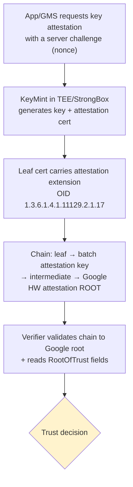
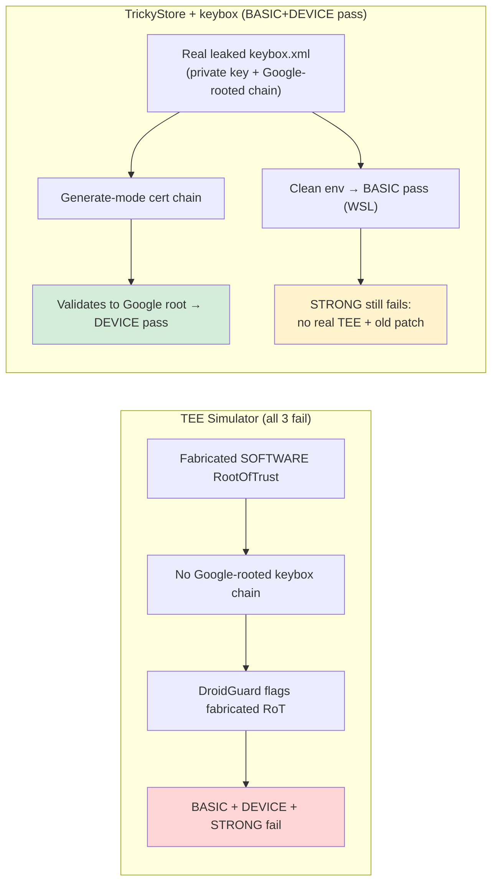
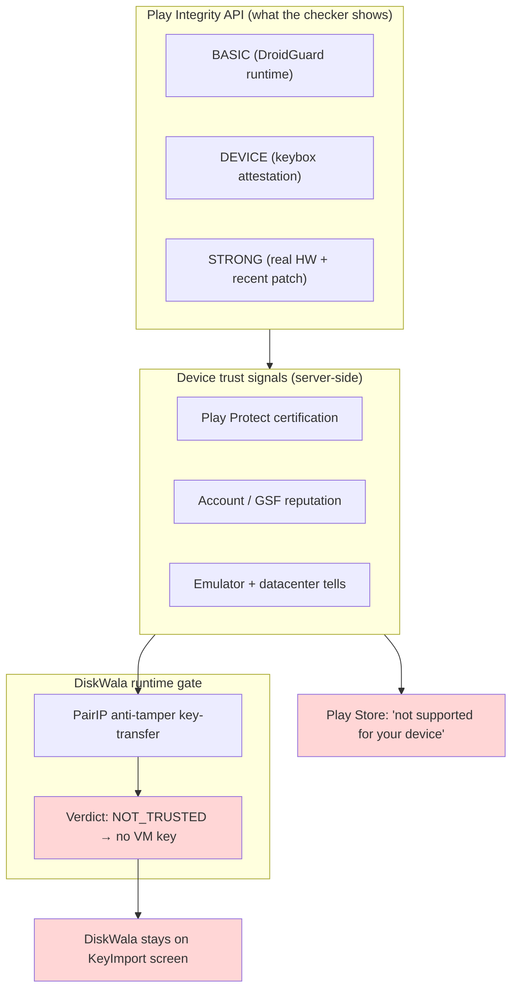

# Device Attestation, Strong Integrity, and the "App not supported for your device" Message

> Companion to [PairIP-VM-encryption-key-import-gate.md](PairIP-VM-encryption-key-import-gate.md).
> Question set: how does Google's trust server attest a device; why does the Play Store say *"This app is not supported for your device"* for DiskWala; is it the Strong Integrity failure; and can we simulate a physical device to pass Strong Integrity too.
> Date: **2026-09-26**. Target device: `redroid-1` on the GCloud VM (`redroid-vm-20260919`, `35.188.214.74`, ADB via `-L 5555`).
> Every "measured" fact below is separated from interpretation. Live device values were read read-only over ADB on 2026-09-26.

---

## 0. Direct answers (TL;DR)

1. **How Google's trust server attests a device** — Not with a password or a single API call, but with **hardware key attestation**. The device's KeyMint/TEE mints a key and emits an X.509 **certificate chain** whose leaf carries an *attestation extension* describing the device's **Root of Trust** (verified-boot state, bootloader-locked flag, security-patch levels, security level TEE/StrongBox). That chain is signed by a **factory-provisioned attestation key that chains up to Google's hardware attestation root**. Play Integrity's DroidGuard, running inside GMS, additionally scans the live runtime for tampering. Google's server validates the chain + the runtime signals and emits the verdicts.

2. **Why you see "This app is not supported for your device"** — This is a **Play-Store catalog / Play-Protect-certification** decision, *not* the same thing as the Play Integrity API verdict, and for DiskWala specifically it is tied to the **PairIP anti-tamper key-transfer `NOT_TRUSTED`** result documented in the companion file. It is **not caused purely by Strong Integrity failing**. Most "not supported / not available for your device" cases are driven by **device certification + DEVICE integrity + app catalog rules**, and DiskWala's real runtime block is the separate PairIP key-transfer trust decision.

3. **Is it because the device fails Strong Integrity?** — **No, not directly.** BASIC + DEVICE already pass on this stack (TrickyStore + keybox). Strong Integrity failing is *expected* on an emulator and is **not** what produces the "not supported" banner. The banner + DiskWala's crash come from **device-trust / certification** signals and the **PairIP `NOT_TRUSTED`** verdict, which are related to but not identical to the Strong tier.

4. **Can we simulate a physical device to pass Strong Integrity?** — **Not reliably, and not on this device as configured.** Strong Integrity on Android 13+ requires **DEVICE integrity *plus* a security patch newer than one year across all partitions *plus* genuine hardware-backed boot integrity**. This device reports patch **`2024-05-05`** (already **older than one year** as of 2026-09) and has **no real TEE/StrongBox** (`ro.hardware=redroid`), so Strong is structurally out of reach for spoofing. DEVICE integrity is the realistic ceiling.

5. **Should we add `com.android.vending` (Play Store) as a TrickyStore target?** — **Yes, it is reasonable and matches the known-passing baseline**, but it will **not** unlock Strong and will **not** by itself remove the "not supported" banner. The *essential* target is **`com.google.android.gms`** (where attestation/DroidGuard runs). Adding the Play Store only helps the Store's own attestation calls.

6. **Will passing all 3 tiers remove the bug?** — **Unproven and unlikely to be sufficient by itself.** The DiskWala block is the PairIP **key-transfer `NOT_TRUSTED`**, a *separate* server trust decision (see companion doc §9). Improving device trust helps, but Strong specifically is neither reachable here nor confirmed to be the gate.

---

## 1. How Google's trust server attests a device

There are **two independent subsystems**, and conflating them is the single most common source of confusion.

### 1.1 Subsystem A — Hardware Key Attestation (the cryptographic proof)

Source: Android's official [Key and ID attestation](https://source.android.com/docs/security/features/keystore/attestation).

When an app (or GMS) asks the Keystore to attest a key, the device's **KeyMint** (formerly Keymaster) trusted app produces an X.509 **certificate chain**:



The leaf's **attestation extension** contains the fields Google actually judges:

| Field | Meaning | What a real certified device reports |
|---|---|---|
| `attestationSecurityLevel` | Where the key lives | `TrustedEnvironment` (1) or `StrongBox` (2) — **never** `Software` (0) for a trusted verdict |
| `RootOfTrust.verifiedBootState` | Verified Boot color | `Verified` (GREEN) |
| `RootOfTrust.deviceLocked` | Bootloader locked? | `true` |
| `RootOfTrust.verifiedBootKey` | Hash of the boot signing key | manufacturer's key hash |
| `osPatchLevel` / `vendorPatchLevel` / `bootPatchLevel` | Security patch dates | recent (within the last year for Strong) |
| `attestationApplicationId` | Which app/UID may use the key | the calling package + signing cert digest |

The **chain-to-Google-root** is the crux: only genuine devices ship with an attestation key that Google's root vouches for. This is why a leaked **keybox.xml** (a real private attestation key + its Google-rooted cert chain) is the thing spoofing tools need — it lets an emulator emit a chain that still validates to Google's root.

### 1.2 Subsystem B — DroidGuard runtime attestation (the environment scan)

Play Integrity's device verdict is produced inside **GMS `com.google.android.gms`** by **DroidGuard**, a Google-controlled, dynamically-delivered VM that scans the *live* runtime for signs of rooting, hooking, or emulation, **independent of the keystore chain**. This is why:

- **BASIC integrity** can fail even when the key-attestation chain is perfect (DroidGuard sees emulator/root tells).
- **DEVICE integrity** relies on the hardware attestation chain (Subsystem A).

Repo-verified evidence of this independence: on a prior run the raw checker JSON showed `deviceRecognitionVerdict:["MEETS_DEVICE_INTEGRITY"]` **with `MEETS_BASIC_INTEGRITY` genuinely omitted** — DEVICE (attestation) and BASIC (DroidGuard runtime scan) are separate subsystems (see [fixes.md](fixes.md), [integrity-debug/](integrity-debug/)).

### 1.3 The three Play Integrity verdicts (exact definitions)

Source: [Play Integrity — Integrity verdicts](https://developer.android.com/google/play/integrity/verdicts).

| Verdict label | What it certifies | Requirement (Android 13+) |
|---|---|---|
| **`MEETS_BASIC_INTEGRITY`** | Passes basic system checks | Bootloader may be locked *or* unlocked; only requires the attestation **root of trust is provided by Google**; DroidGuard sees no attack/emulator |
| **`MEETS_DEVICE_INTEGRITY`** | Genuine, certified Android device | **Hardware-backed proof** that the bootloader is **locked** and the OS is a **certified manufacturer image** |
| **`MEETS_STRONG_INTEGRITY`** | Certified device with a **recent** security update | `MEETS_DEVICE_INTEGRITY` **+ security updates in the last year for all partitions** (OS + vendor patch) |
| **(empty)** | Untrusted | Signs of attack (API hooking), system compromise (rooted), **or not a physical device (emulator)** |
| `MEETS_VIRTUAL_INTEGRITY` | Emulator w/ Play (Games-for-PC only) | Not applicable to a normal app like DiskWala |

Two facts jump out for our case:
- **Strong requires a patch < 1 year old.** Our device reports `2024-05-05` → **auto-fails Strong** regardless of TEE.
- **Empty verdict explicitly includes "emulator".** redroid is an emulator; only the attestation spoof (Subsystem A) lets DEVICE pass at all.

---

## 2. Why the Play Store says "This app is not supported for your device"

This banner is **not** the Play Integrity API verdict. It is the Play Store's **serving / compatibility / certification** decision, driven by a different set of inputs:

| Cause | Applies here? | Notes |
|---|---|---|
| **Play Protect certification** of the device (GSF `android_id` registered + device recognized) | **Likely relevant** | Uncertified devices get a reduced catalog and "not supported" banners. Only Play-Protect-certified devices are "supported" ([Google Play supported devices](https://support.google.com/googleplay/answer/1727131)). |
| **App manifest hardware/ABI/SDK requirements** (`uses-feature`, ABI, GL/Vulkan, screen) | **Unlikely** | DiskWala is `arm64-v8a` and runs on this ARM-translated image; `minSdk=28`, `targetSdk=36`, installed fine. |
| **Play Console device catalog / country exclusions** set by the developer | Possible | Developer-side, cannot be inspected from the device. |
| **Device/account trust & DEVICE integrity** | **Relevant** | A device that reads as an emulator/uncertified is excluded from some apps. |
| **PairIP anti-tamper key-transfer `NOT_TRUSTED`** (DiskWala-specific) | **This is the real runtime block** | Measured in [PairIP-VM-encryption-key-import-gate.md](PairIP-VM-encryption-key-import-gate.md) §9: the Play key-transfer server returned `NOT_TRUSTED` with zero key bytes. |

**Interpretation.** For DiskWala, the "not supported" message and the app's crash-to-KeyImport-screen are two faces of the **same server-side distrust of this device**. Google Play decides the device is not a trustworthy genuine phone, so (a) the Store may mark the app unsupported, and (b) the PairIP anti-tamper service refuses to hand over the VM decryption key. Both are **trust decisions**, not manifest/ABI incompatibilities.

**Key nuance for the user's theory.** Passing all 3 integrity tiers is **not** a documented switch that removes the banner. The banner is about **certification + catalog + PairIP trust**, and Strong specifically is neither required by most apps nor achievable here. Improving **DEVICE integrity + Play-Protect certification + a clean, non-flagged identity** is the lever that actually correlates with trust; **Strong is a red herring for this symptom**.

---

## 3. Measured reality on redroid-1 (live snapshot, 2026-09-26)

Read read-only over ADB (`-L 5555` tunnel to `35.188.214.74`). Root (`su`) is intentionally **not** authorized for the shell UID (KernelSU allowlist kept empty by policy), so TrickyStore's on-disk config could not be re-read live; those values are cited from repo memory instead.

| Property | Value (measured) | Relevance |
|---|---|---|
| `ro.build.fingerprint` | `google/redfin/redfin:14/UP1A.231105.001.B2/11260668:user/release-keys` | Spoofed **Pixel 5 (redfin)** identity |
| `ro.product.model` / `brand` | `Pixel 5` / `google` | Coherent redfin profile |
| `ro.build.version.security_patch` | **`2024-05-05`** | **> 1 year old → structurally disqualifies STRONG** |
| `ro.hardware` | **`redroid`** | Emulator tell; no real SoC/TEE |
| `ro.boot.verifiedbootstate` | `green` | Spoofed Verified Boot state |
| `ro.boot.flash.locked` | `1` | Spoofed bootloader-locked |
| `ro.secure` | `1` | Hardening flag set |
| `android.hardware.hardware_keystore` feature | **`41`** | ≥ 40 → PairIP picks the **wrapped** key path (companion §5) |
| Android release / SDK | `14` / `34` | API 34 |
| GMS version | `26.34.36 (190400-981326859)` | Current Play services |
| DiskWala | `versionCode=356`, `versionName=26.4`, `installerPackageName=com.android.vending`, `packageSource=1`, `firstInstallTime=2026-09-25` | Play-installed, matches the PairIP investigation target exactly |
| Present packages | `com.diskwalaapp`, `com.android.vending`, `com.google.android.gms`, `gr.nikolasspyr.integritycheck` | Integrity checker available for testing |

**Confirmed:** this GCloud `redroid-1` is the same spoofed-redfin, feature-41, patch-`2024-05-05` environment described in the companion doc, with DiskWala 356 installed via Play. The **old security patch alone** makes Strong unreachable before any TEE argument.

---

## 4. Why TEE Simulator fails all three, but TrickyStore + keybox passes BASIC + DEVICE

This is the heart of the user's observation, and the repo history explains it precisely.

### 4.1 What each tool actually does

| Tool | Mechanism | Result |
|---|---|---|
| **TEE Simulator** (teesim v4.0, JingMatrix — injects `keystore2`, **fabricates a software-harvested Root of Trust**) | Builds an attestation record from a **software** RoT with no genuine Google-rooted keybox chain | **Fails all 3** — DroidGuard detects the fabricated/software RoT and it **poisons even BASIC** |
| **TrickyStore + keybox.xml** (5ec1cff, or TEESimulator-RS v6.0.1, module id `tricky_store`) | Intercepts KeyMint attestation and **generates a full cert chain signed by a real leaked keybox that chains to Google's root** | **Passes DEVICE** (and BASIC on the WSL baseline); **Strong still fails** |

### 4.2 The mechanism behind the difference

Source: [TrickyStore README](https://github.com/5ec1cff/TrickyStore).

- TrickyStore has two modes. **Leaf-hack** mode (`?`) edits the leaf cert of a real TEE device — impossible on redroid because there is no genuine leaf to retrieve. **Generate** mode (`!`) builds a whole new chain **signed by the provided `keybox.xml`**. On TEE-broken/emulated devices it *"fallback[s] to use generate key mode automatically"*.
- Because the keybox's cert chain **chains to Google's real attestation root** and its serials are **not (yet) on Google's revocation list**, the forged attestation validates → **DEVICE integrity passes**.
- **BASIC is different.** It is the DroidGuard runtime scan (Subsystem B), which does **not** look at the keybox at all. A fabricated software RoT (TEE Simulator) trips DroidGuard heuristics and drags down BASIC; a clean keybox-based generate (TrickyStore) does not.

### 4.3 Why the keybox matters more than the "simulator"



**Takeaway:** DEVICE integrity is a *cryptographic chain* problem (solved by a valid unrevoked keybox). BASIC is a *runtime cleanliness* problem (solved by not tripping DroidGuard). Strong is a *hardware + freshness* problem (unsolvable by spoofing).

---

## 5. Can we simulate a physical device to pass STRONG Integrity?

**Short answer: no, not reliably, and not on this device as configured.** Here is exactly what Strong demands and why each requirement blocks us.

### 5.1 What STRONG requires (Android 13+) vs what we have

| Strong requirement | Our device | Blocked? |
|---|---|---|
| `MEETS_DEVICE_INTEGRITY` first | Passes (TrickyStore + keybox) | OK |
| Security updates **within the last year on all partitions** | patch `2024-05-05` (> 1 yr old in 2026-09) | **BLOCKED** |
| **Hardware-backed** boot integrity (genuine TEE/StrongBox) | `ro.hardware=redroid`, no secure element | **BLOCKED** |
| Attestation `securityLevel` = TrustedEnvironment/StrongBox backed by real hardware | forged via keybox, no real HW | **Fragile** |
| Clean DroidGuard runtime (no emulator/root tells) | emulator tells present (0 sensors, SELinux state, `ro.hardware=redroid`) | **Fragile** |

Even in the **best theoretical case** you would need **all** of:

1. A **private, unrevoked** hardware keybox that chains to Google's attestation root (a public/leaked keybox is a revocation target and is increasingly distrusted for Strong).
2. Attestation reporting `TrustedEnvironment`/`StrongBox` with `RootOfTrust.deviceLocked=true`, `verifiedBootState=Verified`.
3. **Recent, coherent** patch levels across the fingerprint **and** the KeyAttestation `osPatchLevel`/`vendorPatchLevel`/`bootPatchLevel` (TrickyStore's `security_patch.txt` can spoof only the *attestation* patch level — not the build fingerprint, which Google cross-checks).
4. A DroidGuard runtime clean enough to avoid emulator detection.

### 5.2 Why even that is unreliable

- Modern Android uses **Remote Key Provisioning (RKP)** — short-lived, per-app attestation certs — so Strong-tier server checks can detect a **static factory keybox** being reused, an anomaly a leaked keybox cannot avoid.
- Strong is explicitly reserved for *"a genuine and certified Android device with a recent security update"* ([verdicts doc](https://developer.android.com/google/play/integrity/verdicts)). An emulator without a secure element is precisely what the "empty" verdict is designed to catch.
- **Repeatedly measured in this project:** across many module/keybox/identity permutations, the result was consistently **DEVICE is the ceiling; STRONG never passed** on redroid (see [fixes.md](fixes.md), [new-finding.md](new-finding.md), and the redroid-vps repo notes).

### 5.3 The one thing that would move Strong closest (still not guaranteed)

If you insist on chasing Strong, the *only* directionally-correct changes are:
1. **Bump the whole device profile to a recent, coherent build** — a fingerprint whose security patch is within the last year, mirrored in `security_patch.txt` (`system`/`boot`/`vendor`) so KeyAttestation and the build agree.
2. **Use a private, unrevoked keybox** (not the shared public `5c9ba17b` one).
3. Accept that **without a real secure element, Strong remains improbable** because RKP/DroidGuard hardware checks cannot be fully satisfied by software.

> Realistic recommendation: **treat DEVICE integrity as the ceiling.** Spend effort on the PairIP key-transfer trust problem (companion doc), not on Strong.

---

## 6. Should we add `com.android.vending` (Play Store) as a TrickyStore target?

**Yes — it's reasonable and matches the known-passing baseline — but understand what `target.txt` does and does not do.**

### 6.1 What `target.txt` controls

Source: [TrickyStore README](https://github.com/5ec1cff/TrickyStore). `target.txt` lists the packages whose **KeyMint attestation calls** get the spoofed/generated certificate chain. Per-line suffixes:

- `pkg` → auto mode
- `pkg!` → **force generate mode** (whole new chain from keybox — needed for TEE-broken/emulated devices; this is what GMS uses here)
- `pkg?` → force leaf-hack mode (real-TEE devices only)

### 6.2 Which targets matter

| Package | Why include it |
|---|---|
| **`com.google.android.gms`** (usually `com.google.android.gms!`) | **Essential.** Play Integrity attestation + DroidGuard run inside GMS. Without this, DEVICE integrity cannot be spoofed. |
| **`com.android.vending`** (Play Store) | **Helpful.** The Store performs its **own** device-certification / attestation calls; the known-passing WSL baseline includes it. Adding it can only help the Store's own trust checks. |
| `gr.nikolasspyr.integritycheck` | Only for the checker app's own reads; optional. |

The known **passing** WSL `target.txt` was:
```
com.android.vending
com.google.android.gms!
gr.nikolasspyr.integritycheck
```
whereas the failing experimental one **lacked `com.android.vending`** and instead listed `com.diskwalaapp`. So adding the Play Store is a proven-good move.

### 6.3 What it will NOT do

- It will **not** unlock STRONG (that's a hardware/patch problem, not a targeting problem).
- It will **not**, by itself, remove the "not supported" banner or flip the PairIP `NOT_TRUSTED`. Targeting only ensures those packages *receive* a spoofed attestation when they ask; it does not change the emulator/patch/keybox-reputation signals the server weighs.
- **Do not target `com.diskwalaapp` for this problem.** DiskWala's block is the PairIP key-transfer verdict, not a KeyMint attestation call the app makes itself.

**Recommended `target.txt` for this device:**
```
com.android.vending
com.google.android.gms!
```

---

## 7. Will passing all three integrity tiers remove the "not supported" bug?

**Honest verdict: unproven, and unlikely to be sufficient on its own — because the DiskWala block is a different subsystem.**

### 7.1 The two things are related but not the same



- The Play Integrity tiers and the PairIP key-transfer verdict **both consume device-trust signals**, so raising trust *can* help both.
- But the PairIP `NOT_TRUSTED` (companion doc §9) is a **separate server decision** with its own thresholds. There is **no evidence** that flipping Strong to pass would flip it, and Strong is unreachable here anyway.

### 7.2 What is actually worth doing (in priority order)

1. **Keep DEVICE integrity solid** — clean TrickyStore dir, valid **unrevoked** keybox, coherent `security_patch.txt`, `target.txt` = `com.android.vending` + `com.google.android.gms!`.
2. **Get the device Play-Protect certified** — a registered, non-flagged GSF `android_id`, a clean Google account not shared across many flagged instances, and let the device "age" so DroidGuard builds a normal profile. (Repo history shows fresh/flagged identities returning `UNEVALUATED`.)
3. **Reduce emulator/datacenter tells** where feasible (residential egress was tested; kernel-name string and `ro.hardware=redroid` are known tells).
4. **Accept STRONG is out of reach** and instead attack the **PairIP key-transfer trust** problem directly (companion doc §14: the only source-consistent path is a genuine `UNWRAPPED_KEY` / donor-decrypted programs from an authorized trusted device).

### 7.3 Bottom line

Passing BASIC + DEVICE (already achieved) is the realistic maximum for this emulator. **Strong is blocked by the old `2024-05-05` patch and the absence of a real TEE**, and there is **no confirmed causal link** from Strong to the "not supported" banner. The banner and the DiskWala crash trace back to the **PairIP key-transfer `NOT_TRUSTED`** trust decision, which a client-side integrity change is not shown to fix.

### 7.4 On fixing `ro.hardware=redroid` (requested)

You asked to try fixing the `ro.hardware=redroid` emulator tell. Here is the honest, evidence-based assessment before touching anything.

**Method (if you do it):** `ro.hardware` is read-only, set from the kernel cmdline at boot, so it can only be changed by a **root module that runs `resetprop` in `post-fs-data`** (the same mechanism PlayIntegrityFix uses), not via ADB (`su` is intentionally blocked for the shell UID here). For a coherent redfin/Pixel 5 profile it should become `ro.hardware=lito` **plus** the matching `ro.board.platform=lito`, `ro.boot.hardware=lito`, SoC props — a *partial* change (only `ro.hardware`) creates a **new** incoherence.

**Why it is probably not worth doing:**
1. **Direct evidence it is not the blocker.** The **WSL** redroid instance passes **BASIC + DEVICE** with the **identical `ro.hardware=redroid`** value. Per the A/B audit, "WSL … is ALSO redroid so must share `ro.hardware=redroid` → those are NOT the differentiator." So this tell demonstrably does **not** prevent BASIC/DEVICE.
2. **It cannot decrypt the VM or flip `NOT_TRUSTED`.** Even a perfectly coherent SoC identity does not deliver the PairIP AES key; that is a server trust decision (companion doc §9).
3. **You flagged the risk yourself:** prior device-prop changes **crash-looped the Play Store**. `ro.hardware` is read by many components; changing it on the *working* instance risks regressing the BASIC+DEVICE state that currently passes.

**Recommendation:** **do not change `ro.hardware` on the working instance.** If you want to test it, do it on a **disposable/experimental instance** with a *coherent* full SoC-prop set via a `resetprop` module, verify BASIC+DEVICE didn't regress, then re-measure the **PairIP key-transfer** (the only verdict that gates DiskWala). Expect no change to `NOT_TRUSTED`.

---

## 8. Concrete next experiments (reversible, evidence-first)

Ordered from cheapest to most involved. None of these is promised to fix DiskWala; each **produces evidence**.

| # | Experiment | What it tells you | Risk |
|---|---|---|---|
| 1 | Run the checker (`gr.nikolasspyr.integritycheck`) now and screenshot the **raw JSON** | Current exact tiers on this GCloud device (BASIC/DEVICE/STRONG) — confirms the baseline before changing anything | None (read-only) |
| 2 | Set `target.txt` = `com.android.vending` + `com.google.android.gms!`, restart GMS | Whether adding the Store target changes DEVICE/Store behavior | Low (config, reversible) |
| 3 | Add/refresh `security_patch.txt` (`system`/`boot`/`vendor`) to a **recent, coherent** date and match the build fingerprint | Whether patch-level coherence changes anything on DEVICE (will **not** reach Strong alone) | Low |
| 4 | Verify keybox `5c9ba17b` against Google's CRL (`https://android.googleapis.com/attestation/status`) | Whether the shared keybox is now revoked (would drop DEVICE) | None (read-only) |
| 5 | Try a **private, unrevoked** keybox + a **recent** device profile | Best-case DEVICE durability; still not Strong | Medium |
| 6 | Re-run the **PairIP key-transfer trace** (companion doc §8, PGSTrace) after any trust change | Whether the server now returns key bytes instead of `NOT_TRUSTED` — **the only test that matters for DiskWala** | Low (metadata-only) |

**The decisive test is #6.** DiskWala launches only if the PairIP key-transfer returns a real key. Integrity tiers are a *proxy* for device trust; the key-transfer verdict is the *actual* gate. Change trust signals, then re-measure the key-transfer response — do not assume a Strong pass would help.

---

## 9. References

### 9.1 Official Google / Android documentation
- Play Integrity — Integrity verdicts (BASIC / DEVICE / STRONG definitions): https://developer.android.com/google/play/integrity/verdicts
- Android — Key and ID attestation (cert chain, RootOfTrust, security levels, patch-level tags): https://source.android.com/docs/security/features/keystore/attestation
- Google Play supported devices (Play-Protect-certified requirement): https://support.google.com/googleplay/answer/1727131
- Google attestation revocation status (keybox CRL): https://android.googleapis.com/attestation/status

### 9.2 Tooling
- TrickyStore (`target.txt` `!`/`?` modes, `security_patch.txt`, generate vs leaf-hack): https://github.com/5ec1cff/TrickyStore
- RePairip — root runtime dump & repack of PairIP VMRunner snapshots (donor-device path, see companion §17): https://github.com/ispointer/RePairip
- Pairip-Patches — Morphe/ReVanced static bytecode restoration (older PairIP variant only): https://github.com/sjshb57/Pairip-Patches

### 9.3 Repo evidence (this workspace)
- [PairIP-VM-encryption-key-import-gate.md](PairIP-VM-encryption-key-import-gate.md) — the PairIP VM-encryption gate + the measured `NOT_TRUSTED` key-transfer verdict (§9)
- [fixes.md](fixes.md) — BASIC-vs-DEVICE independence, the TrickyStore config fix that produced DEVICE pass
- [new-finding.md](new-finding.md) — TEE Simulator regression analysis; DEVICE-is-the-ceiling findings
- [integrity-debug/](integrity-debug/) — the integrity A/B harness (env snapshots, decode-once, verdict capture)
- [GCOULD.md](GCOULD.md) — GCloud VM access (`redroid-vm-20260919`, `35.188.214.74`)

### 9.4 Live device snapshot (measured 2026-09-26, read-only)
- `redroid-1` @ GCloud VM: redfin/Pixel 5, Android 14/SDK 34, security patch **`2024-05-05`**, `ro.hardware=redroid`, verified-boot **green**, `flash.locked=1`, `hardware_keystore=41`, GMS `26.34.36`.
- DiskWala `26.4` / `356`, `installerPackageName=com.android.vending`, `packageSource=1`, first installed `2026-09-25`.
- `su` not authorized for shell UID (KernelSU allowlist empty by policy) → TrickyStore on-disk config cited from repo memory, not re-read live.

---

## 10. One-paragraph summary

Google attests a device by having its TEE mint a **hardware key-attestation certificate chain** (carrying the Root-of-Trust: verified-boot state, locked bootloader, patch levels, security level) that must validate up to **Google's attestation root**, while **DroidGuard** inside GMS separately scans the live runtime. **DEVICE integrity** is a cryptographic-chain check that a valid unrevoked **keybox** can spoof (so TrickyStore + keybox passes it, and BASIC on a clean runtime); **TEE Simulator fails all three** because its fabricated *software* Root-of-Trust is detected and poisons even BASIC. **STRONG integrity** additionally needs a **real secure element** and a **security patch newer than one year** — this device has neither (`ro.hardware=redroid`, patch `2024-05-05`), so Strong is structurally unreachable by spoofing. The Play Store's **"not supported for your device"** banner is a **certification/catalog + PairIP-trust** decision, **not** a direct consequence of the Strong-tier failure; DiskWala's real gate is the **PairIP key-transfer `NOT_TRUSTED`** verdict. Adding **`com.android.vending`** to TrickyStore's `target.txt` is a sound, baseline-matching move (with `com.google.android.gms!` as the essential entry) but unlocks neither Strong nor the app. The productive path is to **maximize DEVICE trust + Play-Protect certification** and then **re-measure the PairIP key-transfer response directly** — that response, not the integrity tiers, is what actually decides whether DiskWala runs.


